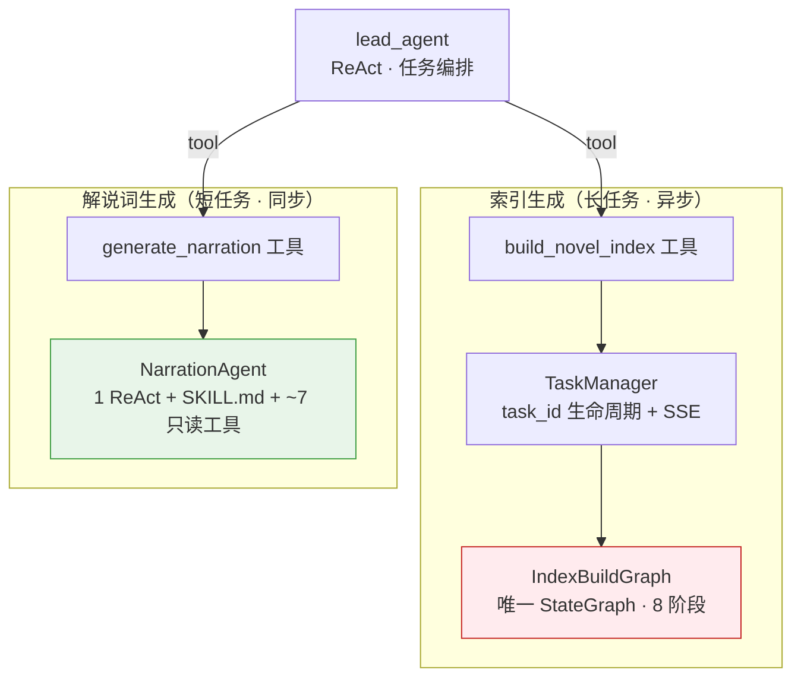
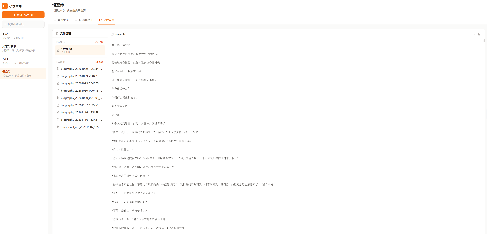
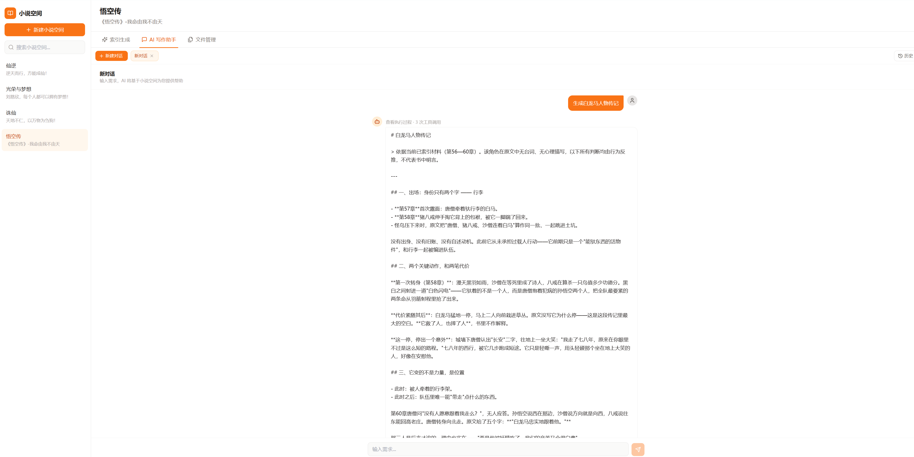
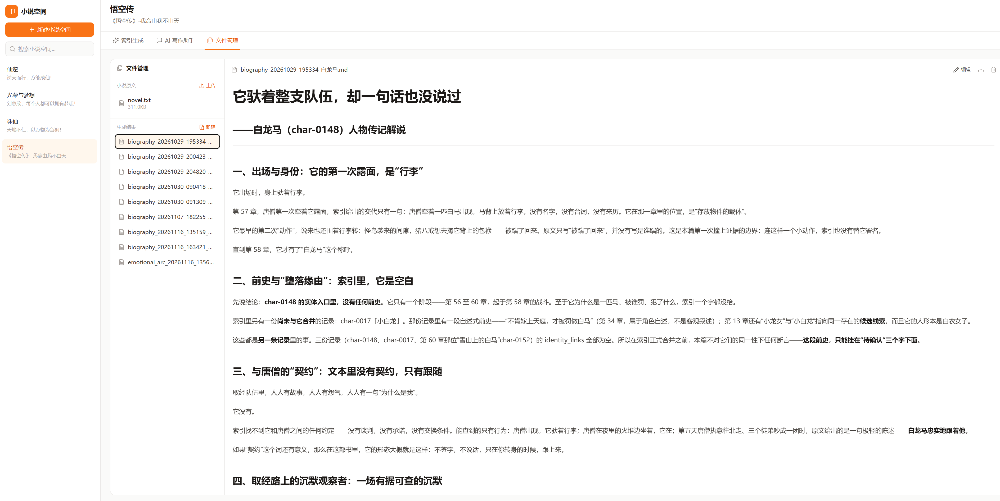
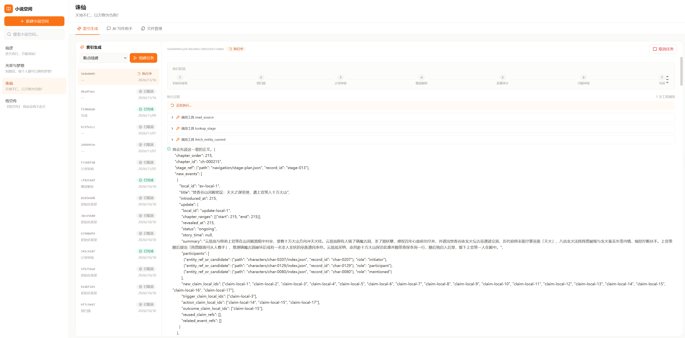

# NovelAnalyst

长篇小说「二创 Agent」系统：输入一本长篇小说原文，产出结构化**索引**（人物 / 事件 / 设定 / 关系 / 剧情），并基于索引按主题生成**解说词**稿件。

在 [DeerFlow](https://github.com/bytedance/deer-flow)（LangGraph + LangChain 的 Agent 框架）基础上二次开发，保留其内核骨架，承载上述两条业务工作流。

---

## 一、两大业务工作流

| 维度 | 索引生成（index generation） | 解说词生成（narration generation） |
|---|---|---|
| 定位 | 输入原文 → 结构化索引（长期构建产物） | 基于索引 → 按主题解说稿件（只读消费） |
| 生命周期 | 小时 ~ 天级 | 秒 ~ 分钟级 |
| 返回方式 | **异步** `task_id` + 轮询 / SSE | **同步**返回完整稿件 |
| 状态 | 有状态机（8 阶段）、可恢复 | 无状态、一次性 |
| 写入 | 大量确定性写入 | 纯只读 |
| 人机协作 | `review_plan` / `review_issues` 两个 interrupt | 无（歧义同步返回） |
| 编排方式 | 固定 StateGraph | 灵活 Skill + 单 ReAct Agent |

**一句话原则**：用 Graph 表达阶段，用 ReAct 表达决策，用 Python 表达控制流；短任务用 skill，长任务用 Graph。

---

## 二、核心架构

顶层一个 `lead_agent`（ReAct）作为**任务编排者**，两条工作流都以「工具」形式挂载，`lead_agent` 不感知内部是 Graph 还是 ReAct：



### 1. 索引生成：固定 StateGraph

- 全局**唯一一个 StateGraph**（`IndexBuildGraph`），星型路由 + `phase` 字段作状态机。
- **8 阶段**：`entry → skeleton → prescan → review_plan(👤) → deepread → audit → review_issues(👤) → derive`。
- **分层 L0–L4**：`lead_agent`（顶层 ReAct）→ 主图节点 → 5 个可复用 ReAct Agent → ~20 个只读 Tool → 6 个底层 Service。
- **核心约束**：只读工具与写入工具严格分离——ReAct Agent 只能用只读/查询类工具，写入类（D 类）只能由节点函数确定性路径调用，防止 LLM 幻觉乱写文件。
- **断点恢复三层**：LangGraph checkpoint（节点级）→ Ledger 四态状态机（章级，**权威事实源**）→ 文件系统 + sha256 CAS（文件级兜底）。

### 2. 解说词生成：灵活 Skill + 单 ReAct Agent

- **1 个 ReAct Agent + 1 个 `SKILL.md` + ~7 个只读工具**，无 StateGraph、无多 Agent、无复杂 State。
- 全部解说方法论（六类任务、下钻顺序、充分性判据、证据分级、边界）沉淀在 `SKILL.md`，改 prompt 不用改代码。
- **三条确定性护栏**（绝不交 LLM 裁决）：名字消歧、覆盖预检、预算守护，内嵌为工具逻辑。

---

## 三、仓库结构

```
NovelAnalyst/
├── deerflow_simple/           # 后端：deer-flow 精简框架 + 业务模块
│   ├── deerflow_simple/       #   Python 包（import deerflow_simple）
│   │   ├── agent.py           #   核心装配（model+tools+middleware+prompt+checkpointer）
│   │   ├── config.py / model.py / state.py / stream.py / checkpointer.py
│   │   ├── middlewares/       #   Context Engineering（摘要/记忆/系统消息合并）
│   │   ├── skills/            #   技能渐进加载
│   │   ├── sandbox/ memory/ subagents/ runs/ mcp/   # 框架内核
│   │   ├── narration/         #   【业务】解说词生成（NarrationAgent + 只读工具）
│   │   ├── index_builder/     #   【业务】索引生成（StateGraph + 节点 + Agent + Service）
│   │   ├── tasks/             #   【业务】长任务运行时（task_id + SSE + interrupt 恢复）
│   │   ├── spaces/            #   【业务】小说空间 + 原文 CRUD（纯后端）
│   │   ├── sessions/          #   【业务】会话 + 线程元数据
│   │   └── app/               #   FastAPI 网关 + 路由（runs/tasks/spaces/sessions）
│   ├── examples/              #   12 个渐进式示例（含解说词/索引测试与客户端）
│   └── pyproject.toml / README.md / AGENT.md
├── frontend/                  # 前端：React + Vite + Tailwind
│   └── src/                   #   小说空间 / 索引生成 / AI 写作助手 / 文件管理
├── design/                    # 设计文档（需求 / 架构 / 图设计 / prompt / 索引模板）
│   ├── doc/                   #   主设计文档（01~04 + 索引模板 + scripts）
│   └── 核心agent设计.md 等     #   落地对照与决策记录
├── jobs/                      # 运行产出（JSON / txt / log）
├── CLAUDE.md                  # 仓库级上下文与设计文档索引
└── README.md
```

> 说明：`deerflow_simple/` 同时是后端项目根（含 `pyproject.toml`），其下 `deerflow_simple/deerflow_simple/` 才是可 `import deerflow_simple` 的 Python 包。

---

## 四、技术栈

- **后端**：Python ≥ 3.12，LangChain + LangGraph，FastAPI + uvicorn，stdlib `sqlite3`（不引 ORM）。
- **前端**：React 18 + TypeScript + Vite + Tailwind CSS。
- **可选依赖**：LangSmith（tracing）、MCP、`langgraph-checkpoint-sqlite`（跨重启恢复）。

---

## 五、快速开始

### 1. 后端

```bash
cd deerflow_simple
uv sync --extra server --extra sqlite   # server 引入 fastapi；sqlite 引入异步 checkpointer
```

配置模型（复制 `.env.example` 后填写，任意 OpenAI 兼容端点均可）：

```bash
export DS_MODEL=deepseek-chat
export DS_BASE_URL=https://api.deepseek.com
export DS_API_KEY=sk-xxxx
```

启动 HTTP API：

```bash
uvicorn deerflow_simple.app.app:app --reload
# 交互式文档：http://127.0.0.1:8000/docs
```

### 2. 前端

```bash
cd frontend
npm install
npm run dev      # Vite 开发服务器，默认代理 /api 到后端
```

### 3. 确定性脚本（可选，索引生成的原型工具）

`design/doc/scripts/` 下 4 个脚本均为 Python 3 纯标准库、零第三方依赖，用于独立验证索引目录的切块 / 骨架 / 分片 / 校验：

```bash
python design/doc/scripts/chunk_novel.py --input novel.txt --novel-root novel \
    --novel-id xianni --source-version source-v1 --title 仙逆 --author 耳根
python design/doc/scripts/init_skeleton.py --novel-root novel --novel-id xianni \
    --title 仙逆 --author 耳根 --language zh-CN --source-version source-v1 --total-chapters 10
python design/doc/scripts/shard_chapters.py --novel-root novel --novel-id xianni --total 10 --size 50 --source-version source-v1
python design/doc/scripts/validate_index.py --root novel --novel-id xianni --source-version source-v1
```

> 这些脚本逻辑已迁移为 `index_builder/nodes/skeleton.py` 的包内纯函数，脚本文件保留作为 CLI 调试入口。

---

## 六、HTTP API 概览

| 模块 | 方法 | 路径 | 说明 |
|---|---|---|---|
| 小说空间 | POST / GET | `/api/spaces` | 创建 / 列出空间 |
| | GET / PUT / DELETE | `/api/spaces/{id}` | 查询 / 更新 / 删除空间 |
| | GET / PUT / DELETE | `/api/spaces/{id}/source` | 原文读取 / 上传 / 删除（唯一文件 `source/novel.txt`） |
| | GET / PUT / DELETE | `/api/spaces/{id}/result/{filename}` | 解说词结果文件 CRUD |
| 会话 | POST / GET | `/api/sessions` | 创建会话（返回默认 thread_id）/ 列表 |
| | GET / DELETE | `/api/sessions/{id}` | 会话详情 / 删除（级联 checkpoint） |
| | POST | `/api/sessions/{id}/threads` | 会话下新建线程 |
| 对话 | POST | `/api/runs` `/api/runs/wait` `/api/runs/stream` | 创建后台 / 阻塞等待 / SSE 流式 run |
| | GET / POST | `/api/threads/{id}/runs`、`/runs/{run}/cancel` | 查询 / 取消 run |
| | GET | `/api/threads/{id}/history` | 线程历史消息 |
| 长任务 | POST / GET | `/api/tasks` | 创建索引任务（异步，立即返回 task_id）/ 列表 |
| | GET | `/api/tasks/{id}` | 查询任务状态（status / phase / error） |
| | POST | `/api/tasks/{id}/stream` | SSE 订阅任务进度（`node` / `tool_call` / `message` 等） |
| | POST | `/api/tasks/{id}/resume` | 恢复 paused 任务（携带 Human-in-Loop 决策） |
| | POST | `/api/tasks/{id}/cancel` | 取消任务 |

统一 SSE 事件协议（`stream.py`）：`message` / `reasoning` / `tool_call` / `tool_result` / `node` / `done`，均带 `source`（`lead` / `narration` / `index`）区分来源。

---

## 七、设计文档

设计文档集中在 `design/`，导航见 `design/doc/AGENT.md`。核心资产：

- `design/doc/01-需求定义.md` / `02-架构设计.md` — 需求边界 / 架构选型。
- `design/doc/03-核心图设计_索引生成.md` — 索引生成 StateGraph（8 阶段 + 工具清单 + 三层恢复）。
- `design/doc/03-核心图设计_解说词生成.md` — 解说词灵活 Skill 版（v2.0）。
- `design/doc/04-prompt_*.md` — 各阶段 prompt 工程。
- `design/doc/novel-index-templates.md` — 索引模板规范 v2.0（索引生成的契约基础）。
- `design/doc/scripts/` — 切块 / 骨架 / 分片 / 校验 4 个确定性脚本。

建议阅读顺序：`01-需求定义 → 02-架构设计 → 03-核心图设计_* → 04-prompt_* → novel-index-templates`。

---
## 八、效果演示

1. 原文



2. 解说词生成



3. 展示解说词



4. 索引生成




