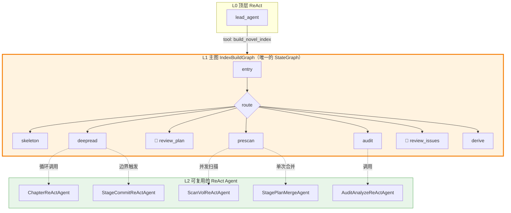
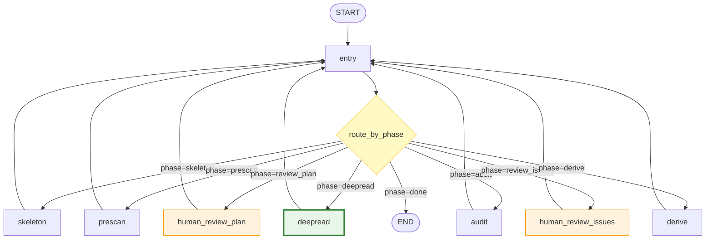
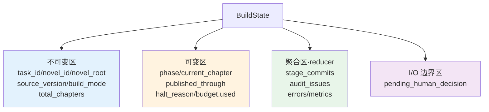
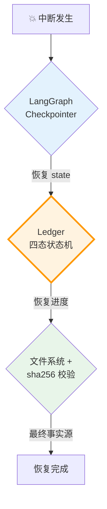
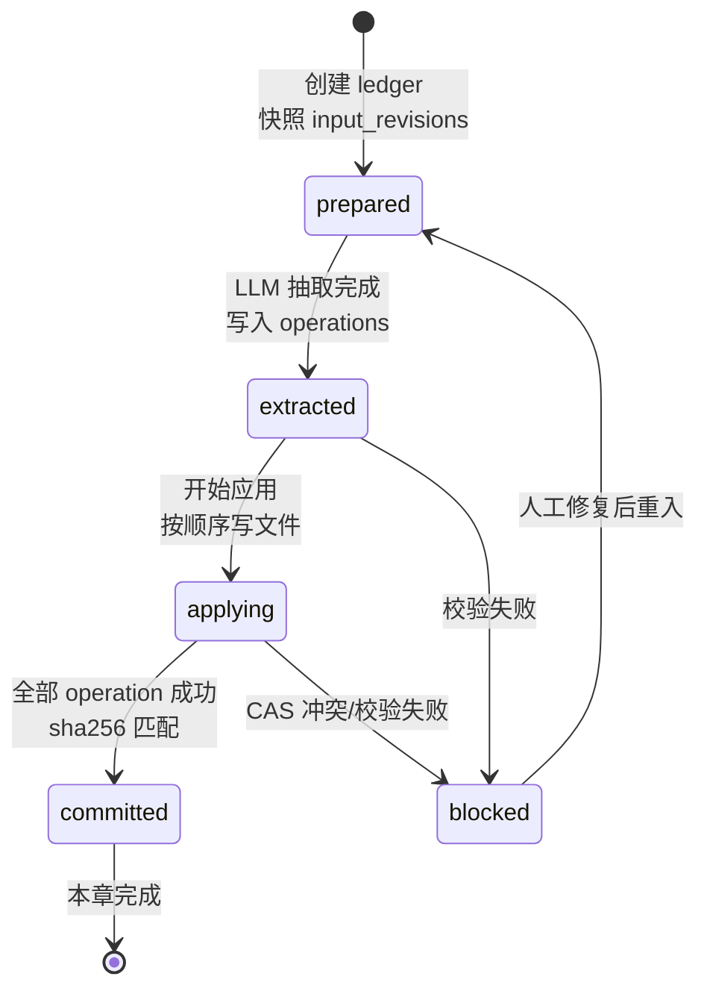
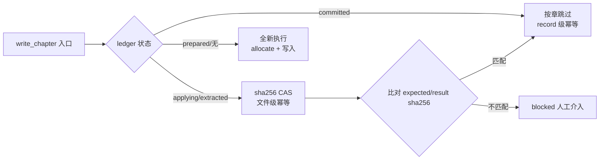
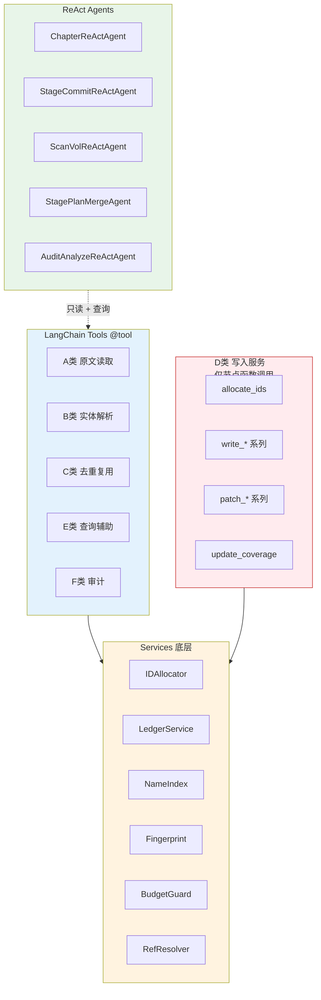
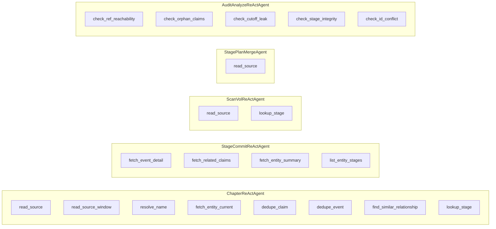

# 核心图设计（索引生成 Graph）

> **版本**：v1.0
> **范围**：解析工作流（索引生成）的 Graph 架构、State、中断恢复、工具清单
> **技术栈**：LangChain + LangGraph
> **上游约束**：遵循《01-需求定义》《02-架构设计》与 `skills/public/novel-index-creator/references/templates.md` v2.0
> **下游产出**：`novel_flow/backend/` 的目录结构与代码骨架规范

---

## 1. 设计原则

### 1.1 两层架构 vs 多层嵌套

> **StateGraph 应该表达"必须串行且有状态机"的流程，而不是任何可分解的逻辑单元。**

| 原则 | 做法 | 反例 |
|---|---|---|
| 外层编排用 Graph | 阶段顺序、断点恢复、人机协作 | ❌ 把 if/for 都塞成子图 |
| 内层决策用 ReAct | 复杂上下文判断、工具自主调用 | ❌ 用条件边硬编码所有分支 |
| 复杂逻辑用 Python | 节点内部用 while/if/try 控制流 | ❌ 用子图来表达循环体 |

**最终形态**：**全局只有 1 个 StateGraph + N 个 ReAct Agent 实例 + 若干 Tool + Services**。

### 1.2 三层职责划分



| 层级 | 单元 | 编排模式 | 职责 |
|---|---|---|---|
| L0 顶层 | lead_agent | ReAct | 理解用户意图、调工具 |
| L1 主图 | IndexBuildGraph | 确定性 Graph | 阶段编排、断点恢复、人机协作 |
| L2 Agent | 5 个 ReAct Agent | ReAct | LLM + 工具自主循环 |
| L3 Tools | ~20 个 LangChain Tool | 函数 | 原文读取 / 实体解析 / 去重 / 查询 / 审计 |
| L4 Services | 6 个底层服务 | 函数 | ID / Ledger / Name / Fingerprint / Budget / Ref |

---

## 2. 主图结构

### 2.1 节点流转图



**关键模式：星型路由**
所有节点完成后都回到 `entry → route_by_phase`，形成单一恢复入口。好处：
- 任何中断后恢复都走统一入口
- 每个节点只关心自己的职责
- `phase` 字段就是整个流程的状态机

### 2.2 节点详细职责

#### N1 `entry`

| 维度 | 说明 |
|---|---|
| 输入 | `task_id` 必填，`build_mode` 可选 |
| 职责 | ① 加载/创建 task 记录<br>② 读 ledger 恢复 `phase`<br>③ 读 `manifest.json` 恢复游标<br>④ 校验 `source_version` 一致性 |
| 输出 | `phase`, `current_chapter`, `published_through`, `budget` |
| 幂等 | ✅ 仅读 + 覆写内存 state |
| 耗时 | 毫秒级 |

#### N2 `skeleton`

| 维度 | 说明 |
|---|---|
| 输入 | 原文 txt 路径、novel_id、source_version |
| 职责 | ① 原文按卷/章切分到 `source/vol-xxx/ch-xxxxxx.txt`<br>② 创建 8 大主题目录<br>③ 写 `manifest.json`<br>④ 初始化 `ledger/id-state.json`<br>⑤ 初始化 `quality/coverage.json`<br>⑥ 写 `source/index.json` 和各卷 index |
| 输出 | `phase = "prescan"`, `total_chapters` |
| 幂等 | ✅ 已存在文件按 sha256 跳过 |
| 耗时 | 秒级 |
| 失败处理 | 连续失败 ≥3 → `halt_reason="skeleton_io"` |

#### N3 `prescan`

| 维度 | 说明 |
|---|---|
| 输入 | source 清单 |
| 职责 | ① 按卷切块<br>② **Python 并发**调 `ScanVolReActAgent` 做 fan-out 扫描<br>③ 收集各卷 `VolReport` 落盘到 `_staging/prescan/vol-xxx.json`<br>④ **单次**调 `StagePlanMergeAgent` 做 fan-in 合并<br>⑤ 产出 `stage-plan.draft.json` + `character_candidates`<br>⑥ 校验阶段连续性 |
| 输出 | `phase = "review_plan"`, `scanned_ranges` |
| 幂等 | ⚠️ 已扫过的卷跳过（看 `_staging/prescan/vol-xxx.done`）；合并步骤看 `_staging/prescan/merge.done` |
| 耗时 | 分钟到小时级（扫描阶段）+ 分钟级（合并阶段） |
| 失败处理 | 单卷重试 ≤2；合并单独重试 ≤2（输入 `VolReport` 已缓存） |
| 用的 Agent | `ScanVolReActAgent`（扫描）、`StagePlanMergeAgent`（合并） |

**节点伪代码**：

```python
async def prescan_node(state: BuildState) -> BuildState:
    vols = list_volumes(state["novel_root"])

    # ① 并发扫描（Python 控制并发，不是 LLM 决策）
    async def scan_one(vol_id: str):
        done_mark = f"_staging/prescan/{vol_id}.done"
        if exists(done_mark):
            return load_vol_report(vol_id)      # 幂等跳过
        for attempt in range(2):
            try:
                report = await scan_vol_react_agent.ainvoke({
                    "task_id": state["task_id"],
                    "vol_id": vol_id,
                    "novel_root": state["novel_root"],
                })
                save_vol_report(vol_id, report)
                touch(done_mark)
                return report
            except Exception:
                if attempt == 1:
                    raise

    vol_reports = await asyncio.gather(*[scan_one(v) for v in vols])

    # ② 单次 LLM 合并（独立 Agent，上下文干净）
    merge_done = f"_staging/prescan/merge.done"
    if not exists(merge_done):
        stage_plan = stage_plan_merge_agent.invoke({
            "task_id": state["task_id"],
            "vol_reports": vol_reports,
            "novel_meta": state["novel_meta"],
        })
        write_stage_plan_draft(state["novel_root"], stage_plan)
        touch(merge_done)

    # ③ 推进 phase
    state["phase"] = "review_plan"
    state["scanned_ranges"] = [r["range"] for r in vol_reports]
    return state
```

**两个 Agent 的职责边界**：

| Agent | 输入 | 输出 | 工具 |
|---|---|---|---|
| `ScanVolReActAgent` | 单卷章节范围 | `VolReport{candidates, stage_hints, 人物提及}` | `read_source`、`lookup_stage`（有工具自主循环需求）|
| `StagePlanMergeAgent` | `List[VolReport]` + `novel_meta` | `stage-plan.draft.json` + `character_candidates` | `read_source`（可选回查原文确认跨卷衔接）|

#### N4 `human_review_plan`

| 维度 | 说明 |
|---|---|
| 输入 | `stage-plan.draft.json` |
| 职责 | 等待人工决策，支持三种动作：<br>① **approve**：批准当前 draft 作为 confirmed stage-plan<br>② **reject**：否决，退回重新预扫描<br>③ **modify**：人工直接编辑 `stage-plan.draft.json`，编辑完成后再提交 approve（批准修订版）或 reject |
| 输出 | `phase = "deepread"`（approve）或退回 `"prescan"`（reject） |
| 实现 | `interrupt_before` + Resume API |
| 耗时 | 分钟到天 |

#### N5 `deepread`（**核心节点**）

| 维度 | 说明 |
|---|---|
| 输入 | confirmed stage-plan、ledger 游标 |
| 职责 | ① 从 ledger 恢复 cursor<br>② while 循环逐章调 `ChapterReActAgent`<br>③ 边界章触发 `StageCommitReActAgent`<br>④ 每章后检查预算/错误/中断<br>⑤ 累计产物到 `stage_commits` |
| 输出 | `phase = "audit"` 或 `halt_reason` |
| 幂等 | ✅ 由 ledger 四态保证 |
| 耗时 | 小时到天 |
| 退出条件 | 全部 committed / halt_reason 置位 / 错误超阈 |
| 用的 Agent | `ChapterReActAgent`、`StageCommitReActAgent` |

**节点伪代码**：

```python
def deepread_node(state: BuildState) -> BuildState:
    cursor = state["current_chapter"] or 1
    error_count = 0

    while cursor <= state["total_chapters"]:
        if check_halt_signal(state):
            state["halt_reason"] = "user_pause"
            return state

        # 1. 单章精读
        try:
            result = chapter_react_agent.invoke({
                "task_id": state["task_id"],
                "chapter_order": cursor,
                "novel_root": state["novel_root"],
                "source_version": state["source_version"],
            })
        except Exception as e:
            error_count += 1
            state["errors"].append({"ch": cursor, "err": str(e)})
            if error_count >= 3:
                state["halt_reason"] = "error_limit"
                return state
            cursor += 1
            continue

        # 2. 边界章触发阶段聚合
        if result.get("stage_boundaries"):
            for boundary in result["stage_boundaries"]:
                stage_commit_react_agent.invoke(boundary)
                state["stage_commits"].append(boundary["stage_id"])

        # 3. 游标推进 + 发布
        cursor += 1
        state["current_chapter"] = cursor
        state["published_through"] = compute_published_through(state)

        # 4. 预算检查
        if state["budget"]["used_tokens"] > state["budget"]["total_tokens"]:
            state["halt_reason"] = "budget_exceeded"
            return state

    state["phase"] = "audit"
    state["current_chapter"] = None
    return state
```

#### N6 `audit`

| 维度 | 说明 |
|---|---|
| 输入 | DeepRead 产物 |
| 职责 | ① **调用检查工具（LLM）**：`AuditAnalyzeReActAgent` 自主调用 5 类检查工具（F 类 · 只读 · 确定性）<br>② **生成检查报告（LLM）**：汇总结果、判定 severity/category、生成 human-readable issue 与 `audit_summary`<br>③ **完成 issue 落盘（节点函数 · 确定性）**：`local_id` → `issue-*`，按 `opened_at` 分片写 `quality/issues/`，更新 issue 高水位 |
| 输出 | `phase = "review_issues"`（有 critical）或 `"derive"` |
| 幂等 | ✅ 审计只读（①②）+ 落盘确定性写入（③） |
| 用的 Agent | `AuditAnalyzeReActAgent`（①②）；节点函数（③） |

**5 类检查工具（F 类 · 只读 · 由 AuditAnalyzeReActAgent 调用）**：
| 检查工具 | 内容 | 对标规范 |
|---|---|---|
| check_ref_reachability | Ref 的 path+record_id 可达 | §11.3 引用 |
| check_orphan_claims | 无主的 claim/event | §11.3 唯一性 |
| check_cutoff_leak | revealed_at > safe_through | §11.3 时间 |
| check_stage_integrity | buffer 都已归档，stage.md 齐全 | §7 stage |
| check_id_conflict | ledger 与实际文件一致 | §11.4 编号 |

#### N7 `human_review_issues`

| 维度 | 说明 |
|---|---|
| 输入 | critical issues 列表 |
| 职责 | 等待人工：fixed / skip / stop |
| 输出 | `phase = "derive"` / `"audit"` / `"done"` |
| 实现 | `interrupt_before` + Resume API |

#### N8 `derive`（可选）

| 维度 | 说明 |
|---|---|
| 输入 | 已 committed 的所有索引 |
| 职责 | ① 构建向量索引<br>② 构建全文倒排索引<br>③ 快照打标签 |
| 输出 | `phase = "done"` |
| 失败处理 | 失败不阻塞主流程，降级为 warn |

### 2.3 节点路由规则

| 当前 phase | 完成后 | 失败时 |
|---|---|---|
| `skeleton` | `prescan` | → entry（重试） |
| `prescan` | `review_plan` | → entry（重试） |
| `review_plan` | `deepread`（approve）| `prescan`（reject） |
| `deepread` | `audit` | END（halt_reason 不为空） |
| `audit` | `review_issues`（有 critical）/ `derive` | → entry（重试） |
| `review_issues` | `audit`（fixed）/ `derive`（skip）/ `done`（stop） | - |
| `derive` | `done` | `done`（降级发布） |

> **关于 `review_plan` 的 modify**：`modify` 不新增路由边。它是一个「人工就地编辑」动作——用户在 interrupt 期间直接修改 `stage-plan.draft.json`，修改完成后的最终决策仍是 `approve`（批准修订版 → `deepread`）或 `reject`（否决 → `prescan`）。

---

## 3. State 设计

### 3.1 完整 BuildState 定义

```python
from typing import TypedDict, Literal, Annotated
from operator import add
from langgraph.graph import add_messages

class BuildState(TypedDict):
    # ① 任务标识（不可变）
    task_id: str
    novel_id: str
    novel_root: str
    source_version: str

    # ② 构建模式
    build_mode: Literal["full", "resume", "repair"]

    # ③ 阶段控制（Graph 状态机）
    phase: Literal[
        "skeleton", "prescan", "review_plan",
        "deepread", "audit", "review_issues",
        "derive", "done"
    ]

    # ④ 进度游标
    total_chapters: int
    current_chapter: int | None
    published_through: int
    scanned_ranges: list[dict]

    # ⑤ 预算守护
    budget: dict  # {total_tokens, used_tokens, warn_threshold, per_chapter_estimate}

    # ⑥ 跨节点结果汇聚（reducer 累加）
    stage_commits: Annotated[list, add]
    audit_issues: Annotated[list, add]
    errors: Annotated[list, add]

    # ⑦ 中断控制
    halt_reason: str | None
    # "budget_exceeded" | "error_limit" | "user_pause" | "io_error" | None

    # ⑧ Human-in-Loop 载荷
    pending_human_decision: dict | None

    # ⑨ 可观测元数据
    started_at: str
    last_checkpoint_at: str
    metrics: dict  # {chapters_processed, llm_calls, tool_calls, retry_count}
```

### 3.2 State 字段分区



### 3.3 不进 State 的数据（关键原则）

LangGraph checkpointer 每次节点执行都把整个 state 序列化落盘。**绝不**把大对象塞进 state：

| 数据 | 存放位置 | 寻址方式 |
|---|---|---|
| 原文内容 | `source/vol-xxx/ch-xxxxxx.txt` | 由 `read_source` 工具按路径读 |
| 章级抽取结果 | `ledger/chapters/*.json` | 由 LedgerService 寻址 |
| stage buffer | `_staging/.../*.buffer.jsonl` | 由 stage_commit 节点聚合 |
| 实体档案 | `characters/*/index.json` 等 | 由 Ref 寻址 |

### 3.4 State 设计三原则

| 原则 | 具体做法 |
|---|---|
| 1. State 瘦身 | 只放"游标 + 聚合结果 + 控制信号" |
| 2. 聚合用 reducer | `Annotated[list, add]`，禁止手动 append |
| 3. 持久化双写 | state 和 ledger 都写，**ledger 为准** |

---

## 4. 中断恢复机制

### 4.1 三层恢复机制



| 层级 | 存储 | 粒度 | 作用 |
|---|---|---|---|
| L1 LangGraph Checkpoint | SQLite | 节点级 | 加速恢复、恢复 messages |
| L2 Ledger 四态 | `ledger/chapters/*.json` | 章级事务 | **权威事实源** |
| L3 FS + sha256 | novel/ 所有产物 | 文件级 | 终极兜底 |

### 4.2 中断类型与恢复策略

| 中断类型 | 触发 | 恢复入口 | 动作 |
|---|---|---|---|
| 进程崩溃 | OS kill / 异常 | `resume_build(task_id)` | checkpoint 恢复 → entry → 当前 phase |
| 预算超限 | `used > total` | 提升预算后 resume | 继续 deepread 循环 |
| 错误累积 | `len(errors) ≥ limit` | 修复后 resume | 跳过失败章或重跑 |
| 用户主动暂停 | `pause(task_id)` | `resume_build(task_id)` | 从暂停处继续 |
| 人工审核等待 | `interrupt_before` | `resume_build(task_id, decision)` | 按决策路由 |
| ledger 冲突 | sha256 CAS 失败 | 自动章级重入 | 重读磁盘 + 二次合并 |

### 4.3 Ledger 四态状态机（权威事实源）



| 状态 | 允许的下一步 | 恢复动作 |
|---|---|---|
| （无文件） | prepared | 全新执行 |
| prepared | extracted / 删除重跑 | 丢弃 ledger，重新 LLM 抽取 |
| extracted | applying | 继续执行 operations |
| applying | committed / blocked | 逐个检查 sha256 决定是否已 applied |
| committed | - | 跳过本章 |
| blocked | 人工介入 | 等待修复 |

### 4.4 典型恢复场景

**场景 A：精读到 ch-100 时崩溃**

```
1. query_task_status(task_id) → state.current_chapter=100, phase=deepread
2. resume_build(task_id)
3. LangGraph 读 checkpoint 恢复 state
4. entry → route_by_phase → deepread
5. 查 ledger/chapters/ch-100.json → status=applying
6. 读 operations[*].expected_sha256 对比当前磁盘 sha256
   - 全匹配 expected → 写入未开始，重跑整章
   - 部分匹配 result_sha256 → 部分已成功，只跑剩余 operation
   - 不匹配任何预期 → blocked，需人工介入
7. 继续 ch-101
```

**场景 B：人工审核超时**

```python
# 1. 启动
graph.invoke({"task_id": "build-001", ...})
# → 跑到 prescan 完成，进入 interrupt_before(human_review_plan)

# 2. 两天后用户回来
status = query_task_status("build-001")
# → status.paused_at = "review_plan"

# 3. 提交决策，恢复
graph.update_state(
    config={"configurable": {"thread_id": "build-001"}},
    values={"pending_human_decision": {"decision": "approved"}}
)
graph.invoke(None, config)
```

### 4.5 对外恢复 API

```python
def start_build(novel_id: str, source_version: str) -> dict:
    """全新启动，返回 task_id"""
    task_id = generate_task_id()
    graph.invoke(
        {"task_id": task_id, "novel_id": novel_id,
         "source_version": source_version, "build_mode": "full"},
        config={"configurable": {"thread_id": task_id}}
    )
    return {"task_id": task_id}

def resume_build(task_id: str, decision: dict | None = None) -> dict:
    """恢复中断的构建。decision 非空=interrupt 恢复；空=崩溃恢复"""
    if decision:
        graph.update_state(
            config={"configurable": {"thread_id": task_id}},
            values={"pending_human_decision": {"decision": decision}}
        )
    graph.invoke(None, config={"configurable": {"thread_id": task_id}})
    return query_task_status(task_id)

def query_task_status(task_id: str) -> dict:
    """查询任务状态"""
    state = graph.get_state(
        config={"configurable": {"thread_id": task_id}}
    )
    return {
        "phase": state.values["phase"],
        "progress": {
            "current": state.values.get("current_chapter"),
            "total": state.values["total_chapters"],
            "published": state.values["published_through"]
        },
        "halt_reason": state.values.get("halt_reason"),
        "pending": state.values.get("pending_human_decision"),
        "metrics": state.values.get("metrics", {})
    }
```

### 4.6 恢复的工程保证

| 保证项 | 实现 |
|---|---|
| 原子性 | 临时文件 + rename、sha256 CAS |
| 幂等性 | ledger 四态 + sha256 校验，重跑不重复写 |
| 可观测 | 每节点 trace span，中断原因入日志 |
| 可审计 | ledger 保留所有历史 operation，不删除 |
| 可诊断 | `query_task_status` 返回所有关键字段 |

### 4.7 增量构建的幂等底线：按章幂等（record 级）

> **阶段说明**：本节是「增量断点恢复」在工程实现阶段**必须补齐**的设计，当前 prompt 验证阶段暂不实现，仅作后续实现的契约约束。

§4.3 四态状态机与 §5.9 Fingerprint 解决的是「文件级」幂等，但若缺少本节的「记录级」幂等，重跑同一章仍会**重复定义 claim/event**——这是增量构建最致命的缺陷，也是工程实现最容易踩的坑。

**三层幂等粒度（由粗到细，缺一不可）：**

| 粒度 | 判断标准 | 解决手段 |
|---|---|---|
| 文件级 | 目标文件是否已存在/被修改 | `expected_sha256` + `result_sha256` CAS（§5.9 Fingerprint） |
| 章节级 | 本章是否已 committed | `ledger/chapters/ch-*.json` 四态状态机（§4.3） |
| **记录级** | 本章的 claim/ev/char 等**是否已分配过 ID** | **复用 `allocated_ids`，禁止重新分配** |

**核心约束（record 级幂等）：**

1. **已 committed 的章节，其 `allocated_ids` 必须原样复用。** 重跑同一章时，若 ledger 中已存在 `allocated_ids`，**不得**再次调用 `IDAllocator.allocate()` 分配新 ID；否则会产生全新的 `claim-*`/`ev-*` 序列，与已写入文件的旧 ID 撞车或产生孤儿记录。

2. **「按章跳过」是幂等的第一道闸。** `write_chapter(chapter_order)` 入口处先读 `ledger/chapters/ch-*.json`：
   - `status == committed` 且 `allocated_ids` 非空 → **直接 return**，不重跑 LLM、不重写文件；
   - `status == applying/extracted` → 走 §4.3 恢复路径，比对 sha256 决定重入点；
   - `status == prepared` 或无 ledger → 全新执行。

3. **写盘前的判重以 `record_id` 为准，不以数组下标为准。** 追加 `events[]` / `entries[]` / `stages[]` 前，必须按 `record_id` 查重；同一 `record_id` 只允许定义一次，重复出现应视为引用或跳过。

**反模式警示（工程实现必须避免）：**

> ❌ **「清空重放」冒充增量**：每次从空目录重建（如 `reset()` 后全量重放），看似幂等，实则丢失了「游标续跑」与「断点恢复」能力——它每次都是全新构建，不是增量。增量构建的判据是：**中途中断后能从断点继续，且不重复定义已提交的记录**，而非「从头跑能得到一样的结果」。

> ❌ **ID 分配与写盘不绑定**：先 `allocate()` 再写文件，若写文件失败，已分配的高水位被空耗。允许空号，但重跑时**不得重新分配已 committed 章节的 ID**。

**与 §4.3 四态、§5.9 Fingerprint 的关系：**



**验收标准：** 任取一章连续执行两次，第二次应零 LLM 调用、零文件变更、`allocated_ids` 不变、ledger 状态仍为 `committed`；全书 `claim`/`ev` 高水位与各文件实际 `record_id` 数量严格一致。

---

## 5. 工具清单

### 5.1 四层架构



**核心约束**：
- **只读工具与写入工具严格分离**
- ReAct Agent 只能用 A/B/C/E/F 类（只读 + 查询）
- D 类写入**只能**由节点函数的确定性路径调用
- 原因：防止 LLM 幻觉导致乱写文件

### 5.2 A 类 · 原文读取类

| 工具 | 用途 | 参数 | 使用者 |
|---|---|---|---|
| `read_source` | 读章节原文（可选段落范围） | `chapter_order`, `para_start?`, `para_end?` | Chapter / ScanVol |
| `read_source_window` | 读相邻章节窗口 | `center_chapter`, `window=2` | Chapter |
| `search_source_anchor` | 在章内搜索指定文本片段 | `chapter_order`, `anchor_text` | AuditAnalyze（二期） |

### 5.3 B 类 · 实体解析类

| 工具 | 用途 | 参数 | 使用者 |
|---|---|---|---|
| `resolve_name` | 名字 → 实体 Ref（含候选） | `name`, `context_hint?` | Chapter / StageCommit |
| `fetch_entity_current` | 读实体 index.json 的 current | `entity_ref` | Chapter / StageCommit |
| `fetch_entity_summary` | 读实体最新 stage 摘要 | `entity_ref` | StageCommit |
| `lookup_stage` | 查某章落在哪个 stage | `chapter_order`, `subject_ref?` | Chapter |

### 5.4 C 类 · 去重复用类

| 工具 | 用途 | 参数 | 使用者 |
|---|---|---|---|
| `dedupe_claim` | 查找等价 Claim 返回已有 Ref | `claim_draft`, `scope_refs` | Chapter |
| `dedupe_event` | 查找等价 Event | `event_draft` | Chapter |
| `find_similar_relationship` | 查找已存在关系对 | `subject_a_ref`, `subject_b_ref` | Chapter |

### 5.5 D 类 · 写入类（节点函数专用）

| 服务 | 用途 | 使用者 |
|---|---|---|
| `allocate_ids` | 批量预留 ID | deepread 节点 |
| `write_event_block` | 写 events/block-xxxx.json | deepread 内部 |
| `write_plot_chapter` | 写 plot/chapters/ch-xxx.json | deepread 内部 |
| `patch_relationship` | 更新 relationships/pairs/rel-xxxx.json | deepread 内部 |
| `patch_setting` | 更新 settings/entries/*.json | deepread 内部 |
| `append_stage_buffer` | 追加 observation 到 buffer | deepread 内部 |
| `write_stage_md` | 写 stage.md 并更新 entity index | stage_commit 内部 |
| `update_coverage` | 更新 coverage 五态 | audit 节点 |

### 5.6 E 类 · 查询辅助类

| 工具 | 用途 | 使用者 |
|---|---|---|
| `fetch_event_detail` | 读已存在 event 详情 | StageCommit |
| `fetch_related_claims` | 读某主体相关 claims | StageCommit |
| `list_entity_stages` | 列实体已有 stage 文件 | StageCommit |

### 5.7 F 类 · 审计类

| 工具 | 用途 | 使用者 |
|---|---|---|
| `check_ref_reachability` | 校验 Ref 的 path+record_id 可达，返回不可达清单 | AuditAnalyze |
| `check_orphan_claims` | 校验无主 claim/event，返回孤儿清单 | AuditAnalyze |
| `check_cutoff_leak` | 校验 revealed_at > safe_through，返回时间泄漏清单 | AuditAnalyze |
| `check_stage_integrity` | 校验 buffer 归档与 stage.md 齐全 | AuditAnalyze |
| `check_id_conflict` | 校验 ledger 高水位与实际文件一致 | AuditAnalyze |
| `check_sha256_match` | 校验文件 sha256 | 恢复/审计（节点） |
| `verify_anchor_in_source` | 校验 anchor 可定位 | AuditAnalyze（二期） |

### 5.8 Agent ↔ 工具对应



### 5.9 底层 Services

| Service | 职责 | 关键方法 | 并发语义 |
|---|---|---|---|
| IDAllocator | ID 高水位分配 | `allocate(kind, count) → ids` | 全局单例 + 文件锁 |
| LedgerService | 四态状态机 | `transition(ch, from_state, to_state)` | 单章互斥 |
| NameIndex | 姓名归一 + 查找 | `normalize(name)`, `lookup(name)` | RWLock |
| Fingerprint | SHA256 + CAS | `sha256(bytes)`, `cas_write(path, data, expected)` | 乐观锁 |
| BudgetGuard | 预算守护 | `check_before()`, `consume(tokens)` | 原子计数 |
| RefResolver | Ref 寻址 + 校验 | `resolve(ref)`, `is_reachable(ref)` | 只读无锁 |

### 5.10 工具设计约束

| 约束 | 说明 |
|---|---|
| 只读/写入严格分离 | ReAct 只给只读工具，防幻觉写入 |
| 写入全走确定性路径 | ReAct 产 structured output → 节点解析 → 调写入服务 |
| 工具调用必须幂等 | 支持重试 |
| 工具失败必须明确报错 | 不吞异常 |
| 工具参数带 novel_root | 支持多小说并行构建 |

---

## 6. 对外接口（给 lead_agent 用）

```python
@tool
def build_novel_index(
    novel_id: str,
    source_version: str = "source-v1",
    mode: Literal["full", "resume", "repair"] = "full",
    task_id: str | None = None,
) -> dict:
    """
    触发索引构建工作流。

    返回:
        {
            "task_id": "build-xxx",
            "status": "running | halted | done | paused",
            "phase": "deepread",
            "progress": {"current": 120, "total": 257, "published": 118},
            "metrics": {"tokens_used": 12000000}
        }

    长任务说明:
        - 立即返回 task_id，异步执行
        - lead_agent 用 query_build_status(task_id) 轮询
        - 中断后用 mode="resume" + task_id 恢复
    """
```

**关键设计**：
- `build_novel_index` 立即返回 task_id，不阻塞 lead_agent
- 用户问进度 → lead_agent 调 `query_build_status`
- Graph 内部异步跑完 → 回写状态 + 通知

---

## 7. 文件组织规范

```
novel_flow/backend/
├── graph.py                      # 唯一的 StateGraph 定义
├── state.py                      # 唯一的 BuildState TypedDict
├── nodes/                        # 主图的 8 个节点函数
│   ├── __init__.py
│   ├── entry.py
│   ├── skeleton.py
│   ├── prescan.py
│   ├── human_review_plan.py
│   ├── deepread.py
│   ├── audit.py
│   ├── human_review_issues.py
│   └── derive.py
├── agents/                       # 可复用的 ReAct Agent 实例
│   ├── __init__.py
│   ├── chapter_react.py
│   ├── stage_commit_react.py
│   ├── scan_vol_react.py
│   ├── stage_plan_merge_react.py
│   └── audit_analyze_react.py
├── tools/                        # LangChain Tools
│   ├── __init__.py
│   ├── source.py                 # A 类
│   ├── entity.py                 # B 类
│   ├── dedupe.py                 # C 类
│   ├── query.py                  # E 类
│   └── audit.py                  # F 类
├── writes/                       # D 类写入服务
│   ├── __init__.py
│   ├── id_alloc.py
│   ├── events.py
│   ├── plot.py
│   ├── relationships.py
│   ├── settings.py
│   ├── buffer.py
│   ├── stage_md.py
│   └── coverage.py
├── services/                     # 底层 Services
│   ├── __init__.py
│   ├── id_allocator.py
│   ├── ledger.py
│   ├── name_index.py
│   ├── fingerprint.py
│   ├── budget_guard.py
│   └── ref_resolver.py
├── schemas/                      # Pydantic 模型
│   ├── __init__.py
│   ├── chapter_extraction.py
│   ├── stage_md.py
│   └── ...
└── api.py                        # 对外三个 API（start/resume/query）
```

---

## 8. 总览速查表

### 8.1 节点速查

| 节点 | 职责 | 耗时 | 内含 Agent |
|---|---|---|---|
| entry | 路由分发 | ms | ❌ |
| skeleton | 骨架初始化 | s | ❌ |
| prescan | 预扫描 + 合并 | min-h | ✅ ScanVol + StagePlanMerge |
| review_plan | 等人工 | - | ❌（interrupt）|
| **deepread** | **核心精读** | h-d | ✅ Chapter + StageCommit |
| audit | 质量审计 | min | ✅ AuditAnalyze |
| review_issues | 等人工 | - | ❌（interrupt）|
| derive | 可选派生 | min | ❌ |

### 8.2 中断恢复速查

| 场景 | 恢复方式 | 入口 |
|---|---|---|
| 崩溃 | checkpoint + ledger | `resume_build(task_id)` |
| 预算超限 | 提升预算后恢复 | `resume_build(task_id)` |
| 人工审核 | 带 decision 恢复 | `resume_build(task_id, decision)` |
| 单章失败 | 自动重试 ≤3 | 内部循环 |
| ledger 冲突 | sha256 CAS | 内部兜底 |

### 8.3 工具速查

| 层 | 数量 | 作用 |
|---|---|---|
| Services | 6 | 底层：ID/Ledger/Name/Fingerprint/Budget/Ref |
| Tools | ~20 | 封装 Services 给 ReAct Agent 用（只读+查询）|
| Writes | ~8 | 写入服务，仅节点函数调用 |
| Agents | 5 | 封装 LLM + Tools 给节点函数用 |
| Nodes | 8 | 组成唯一的 Graph |

### 8.4 风险与应对

| 风险 | 应对 |
|---|---|
| ReAct 死循环调工具 | 设 `max_iterations=10`，超了判失败 |
| buffer 与 ledger 不一致 | buffer append-only，commit 时比对，可丢弃重算 |
| checkpoint 大小爆炸 | state 瘦身，大对象不进 state |
| 预算失控 | BudgetGuard 挂 LLM Callback，超限抛异常 |
| 并发写冲突 | expected_sha256 CAS + 失败后重读合并 |
| 调试困难 | 每个节点一个 trace span，Agent 可独立 invoke 测试 |

---

## 9. 迭代节奏（M1-M6）

| 里程碑 | 周期 | 产出 |
|---|---|---|
| M1 骨架 | 1 周 | Services + Writes + Tools 单测 |
| M2 PreScan | 1.5 周 | prescan 节点 + ScanVolAgent + Human-in-Loop |
| M3 单章 PoC | 2 周 | ChapterReActAgent + ledger 四态端到端 |
| M4 批量精读 | 2 周 | deepread 节点 + StageCommit + Checkpoint |
| M5 审计 | 1 周 | audit 节点 + 发布门槛 + Issue 流 |
| M6 派生 | 1 周 | derive 节点 + Eval 流水线 |

**落地建议**：
- 先做 M3（单章 PoC）再回填 M2
- ledger 用 SQLite 而不是文件（并发安全）
- ReAct 和 Graph 分开迭代（先低模型跑通再升级）
- 先串行再并行（章内 6 路写入初版可串行）
- Human-in-Loop 用 LangGraph `interrupt_before`，不自造轮子

---

## 10. 核心价值总结

1. ✅ **架构简洁**：全局只有 1 个 StateGraph + 5 个 ReAct Agent，心智负担小
2. ✅ **分层清晰**：Graph 编排 / ReAct 决策 / Tools 封装 / Services 基础
3. ✅ **可恢复完备**：双保险（LangGraph checkpoint + ledger 四态），ledger 为 source of truth
4. ✅ **可观测天然**：每节点一个 span，Eval 评测点自然对齐
5. ✅ **人机协作**：PreScan 后、Audit 后两个 interrupt，用户可控
6. ✅ **lead_agent 零负担**：Graph 对外只暴露一个工具 + 异步 task_id 轮询

**一句话原则**：**用 Graph 表达阶段，用 ReAct 表达决策，用 Python 表达控制流。**


## 11. 脚本用法

```bash
# 1. 切块：解析原文，产出 source/ 清单与单章 txt
python3 scripts/chunk_novel.py --input xianni.txt --novel-root novel \
    --novel-id xianni --source-version source-v1 --title 仙逆 --author 耳根

# 2. 骨架：生成 manifest / 导航 / 空主题索引 / ledger / quality
python3 scripts/init_skeleton.py --novel-root novel --novel-id xianni \
    --title 仙逆 --author 耳根 --language zh-CN --source-version source-v1 \
    --total-chapters 10

# 3. 分片：计算章节导航 / 覆盖 / 问题分片范围
python3 scripts/shard_chapters.py --novel-root novel --novel-id xianni --total 10 --size 50 --source-version source-v1

# 4. 校验：结构 / FileMeta / 路径安全 / 章节范围校验，退出码 0/1
python3 scripts/validate_index.py --root novel --novel-id xianni --source-version source-v1
```

四个脚本均为 Python 3 纯标准库，零第三方依赖；JSON 输出统一 UTF-8、两空格缩进、对象键按 Unicode 码点排序、LF、末尾一个 LF（与 §11.5 指纹要求一致）。