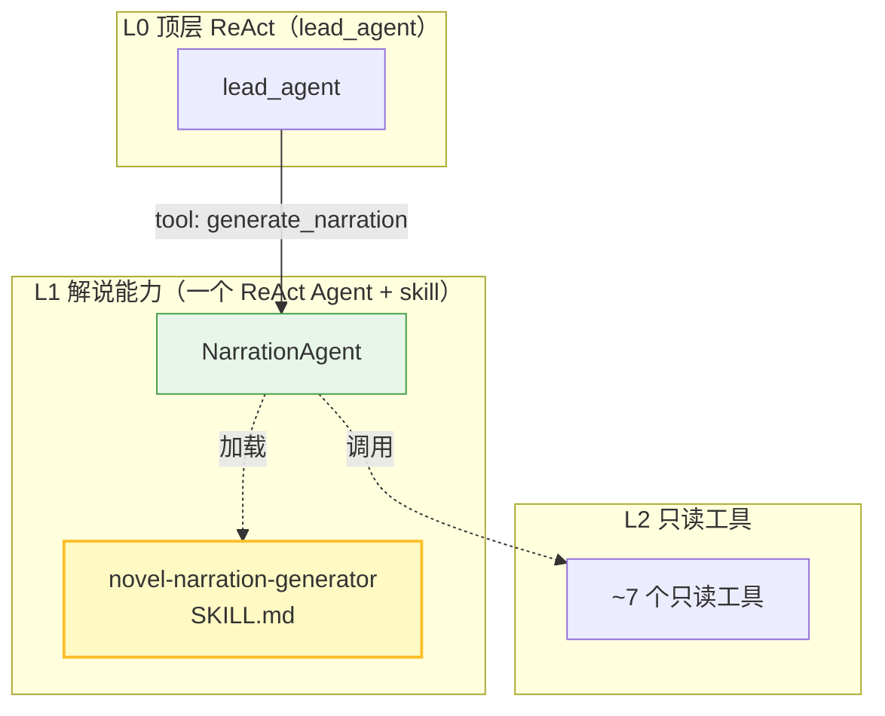

# 核心图设计（解说词生成 · 灵活 Skill 版）

> **版本**：v2.0（重置）
> **范围**：解说词生成的编排方式、Skill 资产、只读工具、证据边界、对外接口
> **技术栈**：LangChain + LangGraph（仅 Orchestrator 层）+ SkillLoader
> **上游约束**：遵循《01-需求定义》《02-架构设计》与 `skills/novel-narration-generator/SKILL.md`
> **下游产出**：`novel_flow/backend/app/runtime/workers/narration.py` 与 `skills/novel-narration-generator/` 的实现规范

---

## 0. 本次重置说明（v1.0 → v2.0）

v1.0 把解说词生成设计成「1 个 StateGraph + 6 节点 + 3 个 ReAct Agent + 13 个工具」的固定工作流。**这是过度设计**：解说词是「秒~分钟级、无状态、纯只读」的 RAG 任务，不需要状态机、不需要断点恢复、不需要把检索/撰稿/审稿硬拆成三个 Agent。

v2.0 重置为**最简单的灵活 Skill 方式**：

| 维度 | v1.0 固定工作流 | v2.0 灵活 Skill |
|---|---|---|
| 编排 | 6 节点 StateGraph（代码硬编码） | 1 个 ReAct Agent（skill 指令驱动） |
| 流程 | 代码写死 parse→resolve→retrieve→verify→draft→critique | LLM 按 skill 下钻自主决策 |
| Agent | 3 个独立类（Retrieval 双 prompt / Writer / Critic） | 1 个 NarrationAgent（单 prompt，角色内切换） |
| 工具 | 13 个细粒度只读工具 | ~7 个粗粒度只读工具 |
| State | 复杂 TypedDict + reducer | 局部变量，无 Graph state |
| 校验改写 | 独立 parse 节点 + RewrittenTask schema | 并入 skill 正文，轻量一步 |

**一句话结论**：把「怎么做解说」写进 SKILL.md，把「怎么执行」交给一个 ReAct Agent，把「不许乱来」做成只读工具 + 确定性护栏。

---

## 1. 设计原则

### 1.1 什么时候用固定工作流，什么时候用 skill

| 任务特征 | 索引生成 | 解说词生成 |
|---|---|---|
| 时长 | 小时~天级 | 秒~分钟级 |
| 状态 | 有状态机（8 阶段） | 无状态 |
| 写入 | 大量写入 | 零写入（纯只读） |
| 断点恢复 | 必须 | 不需要 |
| 流程确定性 | 高（阶段顺序不可变） | 低（读什么材料因任务而异） |
| 编排方式 | 固定 Graph | **灵活 skill** |

> **关键判断**：流程越「因输入而变」，越适合 skill；流程越「固定串行」，越适合 Graph。解说词「读哪些材料、读到哪算够」高度依赖任务本身（人物传记读 stages，势力格局读 factions+relationships），无法用固定边穷举，所以交给 skill + ReAct。

### 1.2 三层分工

| 层 | 载体 | 职责 |
|---|---|---|
| Skill（知识） | `SKILL.md` | 角色、六类任务、下钻顺序、充分性判据、标注规则、边界、产出结构 |
| ReAct Agent（执行） | `NarrationAgent` | 加载 skill，按指令自主决定读什么、何时停、怎么写、怎么自检 |
| Tools + 护栏（约束） | 只读工具 | 封住写入；名字消歧/覆盖预检/预算守护内嵌为确定性逻辑 |

---

## 2. 整体架构



**只有一个 Agent**：`NarrationAgent` 是加载了 `novel-narration-generator` skill 的 ReAct Agent。它不拆成 Retrieval/Writer/Critic 三个类——检索、撰稿、自检是同一个 Agent 在 skill 指引下依次执行的「角色内动作」，靠 prompt 里的阶段指令区分，而非三个独立对象。

> **为什么不拆 3 个 Agent？** 解说词上下文小（材料包几十 KB 以内），一个 Agent 就能装下全部素材；拆 3 个 Agent 反而引入「材料包跨 Agent 传递」的序列化成本和「上下文不共享」的失真。**短任务优先单 Agent，长任务才拆多 Agent。**

> **对外保持对称**：与索引生成一致，lead_agent 通过 `generate_narration` 工具触发解说，不直接感知内部是 Graph 还是 ReAct。

---

## 3. Skill 资产（核心）

### 3.1 SKILL.md 结构

skill 是本设计的核心资产，全部解说方法论都写在这里：

```yaml
---
name: novel-narration-generator
version: "2.0"
description: 基于小说索引的解说词生成专家
allowed-tools:
  - read_file
  - ls
  - load_manifest
  - load_task_routes
  - load_entity
  - load_chapter_ledger
  - search_name
  - ask_clarification
  - report_gap
---
# 正文（见 3.2）
```

### 3.2 正文必须写清楚的内容

| 段落 | 内容 | 目的 |
|---|---|---|
| 角色 | 「你是长篇小说解说生成专家，目标是让没看过原文的人听得懂…」 | 定人设与终极红线 |
| 六类任务 + 必填矩阵 | chapter_plot / biography / faction_landscape / powersystem / relationship / emotional_arc，各自 subject / focus_ranges 必填性 | 任务校验 |
| 下钻顺序 | 目录 → 实体入口 → 阶段摘要 → 事件/陈述 → 原文回读 | 检索路径 |
| 充分性判据 | 核心问题已有依据即停，不以「读完所有关联内容」为目标 | 停止条件 |
| 任务规范化 | 只补全不新增、可追溯、名称歧义交 search_name | 防意图漂移 |
| 确定性标注 | explicit / reported / inferred / uncertain | 证据分级 |
| 边界 | 不编造、升格禁令、revealed_at、安全 | 底线 |
| 产出结构 | 稿件正文 + 章级依据 + 证据标注 + 缺口 | 可评测 |

> **prompt 复用**：任务规范化的详细文案复用 `04-prompt_解说任务优化.md`，名称语义召回的兜底文案复用 `04-prompt_解说任务核查.md`。但二者**降级**：不再有独立的 parse/resolve 节点——任务规范化并入 skill 首段，名称语义召回并入 `search_name` 工具兜底。

### 3.3 与索引生成 skill 的对比

| | novel-index-creator | novel-narration-generator |
|---|---|---|
| 性质 | 有状态构建（写入） | 无状态消费（只读） |
| allowed-tools | 含 write_file / str_replace / append_jsonl | 纯只读 |
| HITL | 有（stage_plan_review） | 无（歧义同步返回） |

---

## 4. 只读工具清单

工具数量从 13 个收敛到 ~7 个，靠「一个工具读一类文件」的粗粒度封装。

| 工具 | 用途 | 确定性护栏内嵌 |
|---|---|---|
| `read_file` / `ls` | 读任意索引/原文文件（沙箱原生） | 路径穿越校验 |
| `load_manifest` | 读 `manifest.json`（index_version / published_through / coverage_ref） | 返回版本与发布覆盖 |
| `load_task_routes` | 读 `navigation/task-routes.json`（required / optional_materials / stop_when） | 材料白名单 |
| `load_entity` | 读实体入口 + 阶段摘要（characters / factions / settings / relationships） | - |
| `load_chapter_ledger` | 读 `ledger/chapters/*`（摘要 / 事件 / claims） | - |
| `search_name` | 名字 → 实体 ref（精确 → 模糊 → LLM 语义召回兜底） | 存在性由代码裁决，LLM 只挑 |
| `ask_clarification` | 向用户澄清阻塞性问题 | - |
| `report_gap` | 报告材料缺口 | - |

**三条确定性护栏（绝不交给 LLM 自由发挥）**：

1. **名字消歧**：`search_name` 内部先做 NFKC 精确匹配 + 模糊匹配，只有两层全 miss 才触发 LLM 语义召回，且 LLM 只能从代码拉出的真实候选列表里挑，禁止编造 ref。
2. **覆盖预检**：`load_manifest` 顺带返回 `coverage` 状态（complete/partial/stale/not_analyzed/no_findings）；`not_analyzed` 直接判「不可完成」，不硬凑。
3. **预算守护**：复用索引生成的 `BudgetGuard`，累计 token 达 90% 即停止扩展加载。

---

## 5. 一次解说的执行流程（软流程）

这不是硬编码节点，而是 skill 引导 LLM 走的路径：


| 步骤 | 谁执行 | 说明 |
|---|---|---|
| 任务规范化 | LLM 单次直调 | 只补全不新增；名称歧义丢给 search_name |
| 名字消歧 | search_name 工具 | 精确→模糊→LLM 兜底 |
| 下钻检索 | LLM 自主循环 | 按 skill 下钻顺序读材料，边读边判充分性 |
| 撰稿 | LLM 生成 | 按文风 + 结构模板，带确定性标注 |
| 自检 critic | LLM 单次判定 | 挑错并给具体改法；不过则回退重写，重试 ≤2 后降级 |

**critic reflection**：自检命中 blocker（证据升格 / 字数偏差 >20% / 前 100 字无钩子 / 结构缺失）则带审稿意见重写，重试 ≤2；仍不过则输出「材料不足」说明稿，不无限循环。

---

## 6. 任务校验与改写（并入 skill）

简化为三条铁律 + 一条边界：

1. **只补全、不新增**：只显式化用户已隐含的信息，不替用户决定核心意图。
2. **可追溯**：每条改动标注依据（原话 / 默认值 / 显式化 / 推断）。
3. **名称歧义交工具**：拿不准的别名/简称一律交 `search_name`，不擅自判定「猴哥就是孙悟空」。
4. **参数合法性短路**：task_type 枚举 / 必填矩阵 / 禁用参数在 `generate_narration` 入口用纯 if/else 校验，不花 token。

---

## 7. 证据与边界

### 7.1 三级证据分层

| 证据级别 | 含义 | 允许的叙述口吻 |
|---|---|---|
| `explicit` | 原文叙述 / 作者旁白 | 直接客观陈述 |
| `reported` | 书中某角色的说法 | 带归属的转述 |
| `inferred` | 索引建立者的推断 | 推测口吻 |
| `uncertain` | 不确定 | 解说腔（仿佛/或许） |

**升格禁令**（写入 skill 正文与自检项）：`reported → explicit`、`inferred → explicit`、无依据 → 任何级别，均严禁。

### 7.2 揭示顺序（revealed_at）

- `revealed_at` 标注信息在哪一章对读者揭示；一期固定 `mode=full`。
- 讲述位置 < revealed_at → 用「后来才揭示」口吻；≥ revealed_at → 可作既成事实。

### 7.3 只读契约

全程只读 `novel/` 索引树；任何工具不得写入、不得更新 coverage、不得追加 ledger。

---

## 8. State（极简）

解说词不需要 LangGraph state。worker 内部用普通局部变量即可：

```python
async def run_narration_worker(state: OrchestratorState) -> dict:
    skill = load_skill("novel-narration-generator")   # 只读资产
    payload = state["task_payload"]                    # 入口参数
    agent = NarrationAgent(skill=skill, tools=TOOLS, budget=BudgetGuard())
    result = await agent.invoke(payload)               # 一次 ReAct 循环跑完
    return {"worker_result": result, ...}
```

- 无 `NarrationWorkerState` TypedDict、无 reducer、无 checkpoint。
- 中间产物（材料、草稿）是 agent 内部的局部变量，不进 state。

---

## 9. 对外接口（给 lead_agent 用）

```python
@tool
def generate_narration(
    novel_id: str,
    task_type: str,
    subject: str | None = None,
    focus_ranges: list[str] | None = None,
    extra_hint: str | None = None,
    output_language: str = "zh-CN",
) -> dict:
    """
    触发解说词生成。短任务，同步返回。

    返回:
        {
            "status": "ok | ambiguity | error",
            "draft": "...",           # 稿件正文
            "chapter_bases": [...],   # 章级依据
            "certainty": {...},       # 证据标注统计
            "gaps": [...],            # 材料缺口
        }
    """
```

对比索引生成的 `build_novel_index`：解说词同步返回完整稿件，无异步轮询；后续可升级为流式（`stream=True` 逐 token 返回 draft）。

---

## 10. 文件组织

```
novel_flow/
├── skills/novel-narration-generator/
│   └── SKILL.md                     # 核心资产：全部解说方法论
├── backend/app/
│   ├── runtime/workers/narration.py # NarrationAgent 装配 + generate_narration 入口
│   ├── sandbox/novel_sandbox.py     # 只读沙箱（read_file/ls）
│   ├── tools/narration.py           # ~7 个只读工具（load_* / search_name）
│   └── llm/budget.py                # BudgetGuard（复用索引生成）
└── prompts/narration/
    ├── generate.v1.md               # 撰稿 prompt（可选，skill 引用）
    └── critic.v1.md                 # 自检 prompt（可选，skill 引用）
```

> 不再新建 `nodes/`、`agents/`、`schemas/`、`services/` 目录；`NarrationAgent` 是单文件装配，`BudgetGuard`/`RefResolver`/`NameIndex` 直接 import 索引生成模块。

---

## 11. 风险与取舍（本方案的边界，重点）

| 风险 | 说明 | 应对 |
|---|---|---|
| ReAct 自由度过大 | LLM 可能乱读、漏读、死循环 | skill 写死下钻顺序 + 充分性判据 + 预算 90% 截断 + max_iterations |
| 三条护栏不可砍 | 名字消歧 / 覆盖预检 / 预算守护若也交给 LLM，会幻觉 | 内嵌为工具确定性逻辑，LLM 只做「挑」不做「裁决」 |
| 可评测性 | 纯 ReAct 中间态不好评测 | 用「确定性标注 + 章级依据」硬性产出约束保证 |
| 意图漂移 | 改写脑补诉求 | 三条铁律 + 可追溯 |
| 证据升格 | reported→explicit | skill 禁令 + 自检项 |

**若后续发现 ReAct 自由度过大、质量不稳定**，可将检索环节回退为「固定下钻」的半硬编码（skill 只保留撰稿与自检），但**先把最简 skill 跑通再谈回退**，避免一上来就过度设计。

---

## 12. 迭代节奏

| 里程碑 | 周期 | 产出 |
|---|---|---|
| M1 只读工具 | 0.5 周 | ~7 个只读工具 + search_name 三层匹配单测 |
| M2 单主题 PoC | 0.5 周 | NarrationAgent + skill 端到端（chapter_plot，材料最全） |
| M3 横向复制 | 0.5 周 | 其余五类接入（只改 task_routes + skill 模板，不改代码） |
| M4 自检 + eval | 0.5 周 | critic reflection + 证据对齐/字数/钩子评测集 |

**落地建议**：先跑通 `chapter_plot` 单主题全链路，再横向复制到另外五类——六类只是 `task_type` + 材料路由不同，Agent 与工具完全复用。

---

## 13. 核心价值总结

1. ✅ **架构最简**：1 个 ReAct Agent + 1 个 skill + ~7 个只读工具，无 StateGraph、无多 Agent、无复杂 State。
2. ✅ **与索引生成对称**：对外都是「lead_agent → tool → worker」，心智负担小。
3. ✅ **知识外置**：解说方法论沉淀在 SKILL.md，改 prompt 不用改代码。
4. ✅ **证据底线不松**：三级证据 + 升格禁令 + 揭示顺序，守住「不编造」。
5. ✅ **成本可控**：只读 + 下钻停止条件 + 预算 90% 截断。
6. ✅ **可回退**：若 ReAct 不稳定，可局部硬编码检索，保留 skill 作为知识层。

**一句话原则**：**解说词用 skill 表达知识，用 ReAct 表达决策，用只读工具表达约束——不为一分钟的 RAG 任务造一个状态机。**
