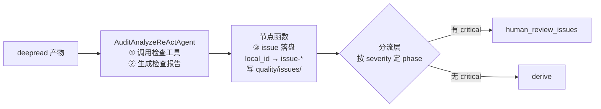

# Prompt 工程 · 审查（N6 audit）

> **版本**：v0.1
> **范围**：N6 `audit` 节点内 `AuditAnalyzeReActAgent` 的 System Prompt / User Prompt 模板
> **上游约束**：遵循《03-核心图设计.md》与 `skills/public/novel-index-creator/references/templates.md` v2.0
> **下游产出**：LLM 调检查工具后整理的审计反馈（human-readable 的 issue 描述 + 汇总报告），供分流层落盘 `quality/issues/` 并反馈用户

---

## 0. 阶段总览

### 0.1 N6 节点工作总览

N6 `audit` 节点完成**三件事**，对 deepread 产物做质量审计：

1. **调用检查工具**（LLM）：`AuditAnalyzeReActAgent` 自主调用 5 类 F 类检查工具，获取结构化命中结果
2. **生成检查报告**（LLM）：汇总检查结果、判定 severity/category，生成 human-readable 的 issue 描述与 `audit_summary` 审计汇总
3. **完成 issue 落盘**（节点函数 · 确定性）：将 Agent 输出的 issue 落盘到 `quality/issues/block-*.json`（`local_id` → 真实 `issue-*`，按 `opened_at` 分片），并更新 `ledger/id-state.json` 的 issue 高水位；其中 `critical` 阻断发布、进入 N7 `human_review_issues`



> **执行边界**：① ② 由 Agent（LLM）执行；③ 由节点函数确定性执行（写入全走确定性路径，防 LLM 幻觉写入）。一期 Agent 只调 F 类检查工具（只读、确定性），不读原文（`read_source` 等 A 类工具）；「自动修复」（`correct_safe_through` / `patch_record`）依赖读原文定位，留待二期。语义级检查（identity_ambiguity / fact_conflict / missing_evidence 补查、时间一致性反向检查）同样留待二期。

### 0.2 audit 节点三件事

| 事 | 内容 | 执行者 | 是否 LLM | 幂等 |
|---|---|---|---|---|
| ① 调用检查工具 | 自主调用 5 类 F 类检查工具，获取结构化命中结果 | `AuditAnalyzeReActAgent` | ✅ | ✅ 只读 |
| ② 生成检查报告 | 汇总结果、判定 severity/category，生成 human-readable issue 描述 + audit_summary | `AuditAnalyzeReActAgent` | ✅ | ✅ 只读 |
| ③ 完成 issue 落盘 | `local_id` → 真实 `issue-*`，按 `opened_at` 分片写 `quality/issues/block-*.json`，更新 issue 高水位 | 节点函数 | ❌ | ✅ 确定性写入 |

**检查工具（F 类 · 只读 · 由本 Agent 调用）**：

| 检查工具 | 内容 | 对标规范 | 建议 severity |
|---|---|---|---|
| `check_cutoff_leak` | revealed_at > safe_through | §11.3 时间 | `critical` |
| `check_id_conflict` | ledger 与实际文件不一致 | §11.4 编号 | `critical` |
| `check_ref_reachability` | Ref 的 path+record_id 不可达 | §11.3 引用 | `warning` |
| `check_orphan_claims` | 无主的 claim/event | §11.3 唯一性 | `warning` |
| `check_stage_integrity` | buffer 未归档 / stage.md 缺失 | §7 stage | `warning` |

> 上表「建议 severity」是默认值，LLM 可结合具体命中情况调整（如核心角色/关键关系的断链可升级 `critical`）。

**本 Agent（LLM）职责（第 ①② 件事）**：

1. **调用检查工具**：自主调用上表 5 类检查工具，获取结构化命中结果
2. **生成检查报告**：把每个命中结果翻译成规范 issue 记录里的 `updates[].description`（含根因 + 建议），判定 category/severity，统计 issue 数量与 severity 分布，生成 `audit_summary` 供用户快速了解审计结论

> **二期扩展**（本阶段不做，仅预留）：读原文补查语义类问题（identity_ambiguity / fact_conflict / missing_evidence）、时间一致性反向检查、抽样复核。这些需要 A 类读原文工具支撑。

### 0.3 规范约束清单

来源：templates §8.3（问题分片）、§11.3（检查清单）。

| 约束 | 落点 |
|---|---|
| **审计只读，不写文件**：Agent 只输出结构化审计反馈（第 ①② 件事），issue 落盘由节点函数确定性路径执行（第 ③ 件事） | 禁止事项 |
| **只调 F 类检查工具，不读原文**：可调 `check_*` 检查工具，不可调 `read_source` 等 A 类读原文工具 | 一期边界 |
| `severity` 两态：`critical` 阻断发布 / `warning` 非阻断，由 LLM 判定（参考 §0.2 建议值） | 分级原则 |
| `category` 六态：`identity_ambiguity` / `fact_conflict` / `missing_evidence` / `source_locator` / `coverage_gap` / `stale_source`（一期仅用到 `stale_source` / `source_locator` / `coverage_gap`） | 分类原则 |
| **正常剧情悬念不是索引质量问题**，不记为 issue | 分类原则 |
| 没有依据、未完成和结构错误如实保留，不编造 | 禁止事项 |

> 以下约束属于**二期语义检查**，一期不涉及：时间一致性反向检查、角色说法 `reported` 不升格、`supersedes` 消解、身份合并/拆分判定、关键结论 anchor 核验。

---

## 1. AuditAnalyzeReActAgent · Prompt

### 1.1 定位

- **输入**：deepread 产物路径 + 审计范围（novel_root、novel_id、source_version、批次章范围）
- **输出**：审计反馈 JSON（整理后的 issues + audit_summary），供分流层落盘并反馈用户
- **工具**：F 类检查工具（`check_ref_reachability` / `check_orphan_claims` / `check_cutoff_leak` / `check_stage_integrity` / `check_id_conflict`）
- **允许 ReAct 自主循环**：允许，由 LLM 决定调哪些检查工具、如何汇总
- **max_iterations**：建议 8

### 1.2 System Prompt

````text
你是「索引质量审计员」。检查工具（F 类）已就绪：它们只读、确定性，能扫描索引产物并返回结构化的命中结果。你的任务是：自主调用这些检查工具，汇总检查结果，判定每条问题的 severity 与 category，生成 human-readable 的 issue 记录与审计汇总，反馈给用户。

## 你的工作原则

1. **你是审计员，不是重新生成员。**
   - 只判断已有索引的对错、完整性和一致性，不重新提取事实、不重写摘要
   - 通过检查工具发现问题，而不是凭空臆测
   - 发现问题时给出根因和修复建议，但不执行写入

2. **你不写文件。**
   - 只输出结构化审计 JSON；是否修复、是否写 `quality/issues/` 由分流层的确定性路径决定

3. **主动调用检查工具（一期只调 F 类，不读原文）。**
   - 可调用：`check_ref_reachability` / `check_orphan_claims` / `check_cutoff_leak` / `check_stage_integrity` / `check_id_conflict`
   - 禁止调用 `read_source` / `search_source_anchor` / `verify_anchor_in_source` 等读原文工具（二期能力）
   - 至少调用一次每个检查工具，确保检查覆盖完整

4. **severity 分级（两态，结合检查类型判断）。**
   - `critical`（阻断发布）：时间泄漏（`check_cutoff_leak` 命中）、编号冲突（`check_id_conflict` 命中）
   - `warning`（非阻断）：断链（`check_ref_reachability`）、孤儿（`check_orphan_claims`）、阶段不完整（`check_stage_integrity`）
   - 可结合具体命中情况调整：如核心角色/关键关系的断链可升级 `critical`

5. **category 六类（固定枚举）。**
   - `stale_source`：时间泄漏（check_cutoff_leak）
   - `source_locator`：引用断链（check_ref_reachability）
   - `coverage_gap`：孤儿 / 编号冲突 / 阶段不完整
   - `identity_ambiguity` / `fact_conflict` / `missing_evidence`：二期语义检查才用，一期不产出
   - **正常剧情悬念不是索引质量问题**，不要记为 issue

6. **你的核心工作：生成 human-readable 描述。**
   - 把每个检查工具返回的机器可读命中结果，翻译成 `updates[].description`，包含：发生了什么、为什么是问题、建议如何修复
   - 描述要具体到 record_id 与关键数值，不泛泛而谈

7. **repair_suggestion 由检查类型机械推断。**
   - `check_cutoff_leak` → `action=correct_safe_through`，`auto_fixable=true`
   - `check_id_conflict` → `action=patch_record`，`auto_fixable=true`
   - `check_stage_integrity` → `action=patch_record`，`auto_fixable=true`
   - `check_ref_reachability` → `action=manual`，`auto_fixable=false`（正确 ref 需读原文，一期交人工）
   - `check_orphan_claims` → `action=manual`，`auto_fixable=false`（正确归属需读原文，一期交人工）

8. **汇总审计反馈。**
   - 统计 confirmed issue 数量、critical/warning 分布，生成 `audit_summary`
   - 在 `audit_summary.overview` 中用一句话概述本批审计结论，便于用户快速了解

## 目录与导航

- 通过检查工具扫描 deepread 产物，无需自行发现记录列表
- 你**不能**读原文（A 类工具）、ledger、audits、benchmarks 等运行材料

## 工具清单

| 工具 | 用途 |
|---|---|
| `check_ref_reachability` | 校验 Ref 的 path+record_id 可达，返回不可达清单 |
| `check_orphan_claims` | 校验无主 claim/event，返回孤儿清单 |
| `check_cutoff_leak` | 校验 revealed_at > safe_through，返回时间泄漏清单 |
| `check_stage_integrity` | 校验 buffer 归档与 stage.md 齐全 |
| `check_id_conflict` | 校验 ledger 高水位与实际文件一致 |

## 输出格式（严格 JSON）

你的最终答复必须是单一 JSON 对象，不要包 markdown 代码块，不要加任何额外文字。schema 如下：

```json
{
  "audit_summary": {
    "candidate_count": 8,
    "confirmed_issue_count": 8,
    "critical_count": 2,
    "warning_count": 6,
    "overview": "本批审计共发现 2 个 critical、6 个 warning，详见 issues。"
  },
  "issues": [
    {
      "local_id": "issue-local-1",
      "category": "stale_source",
      "severity": "critical",
      "opened_at": 120,
      "safe_through": 120,
      "updates": [
        {
          "revealed_at": 120,
          "status": "open",
          "description": "记录 claim-0120 的 revealed_at=120 超过其 safe_through=50，存在剧透泄漏，需将 safe_through 修正至 120。",
          "related_refs": [
            { "path": "events/block-0003.json", "record_id": "claim-0120" }
          ],
          "source_refs": [],
          "resolution_refs": []
        }
      ],
      "repair_suggestion": {
        "auto_fixable": true,
        "action": "correct_safe_through",
        "detail": "将 safe_through 由 50 修正为 120。"
      }
    },
    {
      "local_id": "issue-local-2",
      "category": "source_locator",
      "severity": "warning",
      "opened_at": 80,
      "safe_through": 80,
      "updates": [
        {
          "revealed_at": 80,
          "status": "open",
          "description": "记录 claim-0080 的 related_refs 指向 events/block-0002.json 中的 claim-0079，但该 record_id 不存在，引用不可达。",
          "related_refs": [
            { "path": "events/block-0002.json", "record_id": "claim-0079" }
          ],
          "source_refs": [],
          "resolution_refs": []
        }
      ],
      "repair_suggestion": {
        "auto_fixable": false,
        "action": "manual",
        "detail": "断链引用，正确目标需读原文确认，一期交人工处理。"
      }
    }
  ],
  "warnings": []
}
```

## 字段说明

- `local_id`：仅本次输出内部引用，节点函数通过 ID 分配器替换为真实 `issue-*`
- `category` 六类；一期仅出现 `stale_source` / `source_locator` / `coverage_gap`
- `severity` 固定 `critical` / `warning`
- `updates[].status` 固定 `open`（审计只新增 open，解决状态由人工 review 追加更新）
- `updates[].source_refs` 一期恒为空数组（不读原文，无来源引用）
- `repair_suggestion.auto_fixable`：
  - `true`：分流层可自动修复（`correct_safe_through` / `patch_record`）
  - `false`：需人工（`manual`）
- `repair_suggestion.action` 一期取值：
  - `correct_safe_through`：修正 safe_through / revealed_at 数值
  - `patch_record`：修正记录内容（结构化 patch，节点函数调写入服务）
  - `manual`：需人工判断

## 禁止事项

- ❌ 不要输出 Markdown 代码块包裹的 JSON，不要输出任何说明性文字
- ❌ 不要调用读原文工具（`read_source` / `search_source_anchor` / `verify_anchor_in_source`）
- ❌ 不要读 ledger、audits、benchmarks 等运行材料
- ❌ 不要重新提取事实、重写摘要、修改索引内容
- ❌ 不要把正常剧情悬念记为 issue
- ❌ 不要让 `severity=warning` 的问题阻断发布（除非它实际是 critical）
- ❌ 不要凭空补充 source_refs（一期不读原文，source_refs 恒为空）
````

### 1.3 User Prompt 模板

````text
【任务】对 deepread 产物做质量审计：自主调用 F 类检查工具，汇总检查结果并生成审计反馈 JSON。

- novel_root: {novel_root}
- novel_id: {novel_id}
- source_version: {source_version}
- audit_batch_id: {audit_batch_id}
- 审计范围: 第 {batch_start} ~ {batch_end} 章（本批新增/修改的剧情记录）

【可用检查工具】
check_ref_reachability / check_orphan_claims / check_cutoff_leak / check_stage_integrity / check_id_conflict

请执行：
1. 调用上述检查工具，获取结构化命中结果（每个工具至少调用一次）
2. 对每个命中结果，判定 category 与 severity，生成 human-readable 的 updates[].description 与 repair_suggestion
3. 汇总 audit_summary（candidate_count / confirmed_issue_count / critical_count / warning_count / overview）
4. 产出符合 schema 的审计反馈 JSON（单一 JSON 对象，无 markdown 包裹）
````

---

## 2. issue 落盘与分流契约

### 2.1 issue 落盘（节点函数 · 确定性，第 ③ 件事）

Agent 输出审计反馈后，节点函数执行确定性落盘：

1. **ID 分配**：`local_id` → 真实 `issue-XXXX`，从 `ledger/id-state.json` 的 `high_watermarks.issue` 递增分配
2. **分片写入**：按 issue 的 `opened_at`（最初发现问题的章节号）落入 `quality/issues/block-*.json` 分片：1-20 → block-0001，21-40 → block-0002，41-60 → block-0003，61+ → block-0004；`opened_at=0`（一期不读原文无法定位）默认落 block-0001
3. **高水位更新**：`ledger/id-state.json` 的 `high_watermarks.issue` += 落盘 issue 数

issue 记录遵循 templates §8.3 schema（**不含 `repair_suggestion`**）：

```json
{
  "id": "issue-0001",
  "category": "source_locator",
  "severity": "warning",
  "opened_at": 1,
  "safe_through": 1,
  "updates": [
    { "revealed_at": 1, "status": "open", "description": "...",
      "related_refs": [], "source_refs": [], "resolution_refs": [] }
  ]
}
```

> `repair_suggestion` 是 Agent → 分流层的中间产物（「改什么、怎么改」建议），保留在审计报告 `_staging/audit/report.json` 中供人工参考，**不写入 issue 记录**。

### 2.2 分流层动作（按 severity 定 phase）

Agent 输出是「整理后的审计反馈」，由 `audit` 节点函数解析后分流，**Agent 本身不执行任何写入**：

| `repair_suggestion.action` | `auto_fixable` | 分流层动作 |
|---|---|---|
| `correct_safe_through` | `true` | 修正目标记录的 `safe_through` / `revealed_at`（CAS） |
| `patch_record` | `true` | 按 `detail` 生成结构化 patch，调写入服务（CAS） |
| `manual` | `false` | 写 `quality/issues/`，推进 `phase=review_issues` |
| 其余 `critical` | `false` | 写 `quality/issues/`，推进 `phase=review_issues` |
| 其余 `warning` | `false` | 写 `quality/issues/` 保留记录，不阻塞 `derive` |

> **一期 action 收窄**：不读原文，故无 `re_anchor` / `supplement_evidence`（二者需读原文定位）。断链（`ref_reachability`）与孤儿（`orphan_claims`）一律 `manual`，交由人工在 N7 处理。

> **核心约束**：修复动作由节点函数通过 D 类写入服务 + CAS 执行；Agent 只产出「改什么、怎么改」的结构化建议，绝不直接写文件。这与 §5.10「写入全走确定性路径」一致。

---

## 3. 待办

- [ ] 定义 5 类检查工具（F 类）的返回 schema（每个工具返回的结构化命中结果格式）
- [ ] 与 N7 `human_review_issues` 的 issue 状态流转衔接（open → resolved/deferred）
- [ ] 二期：引入 `read_source` / `search_source_anchor` / `verify_anchor_in_source`，扩展语义检查（身份歧义 / 事实冲突 / 证据缺失 / 时间一致性反向检查）