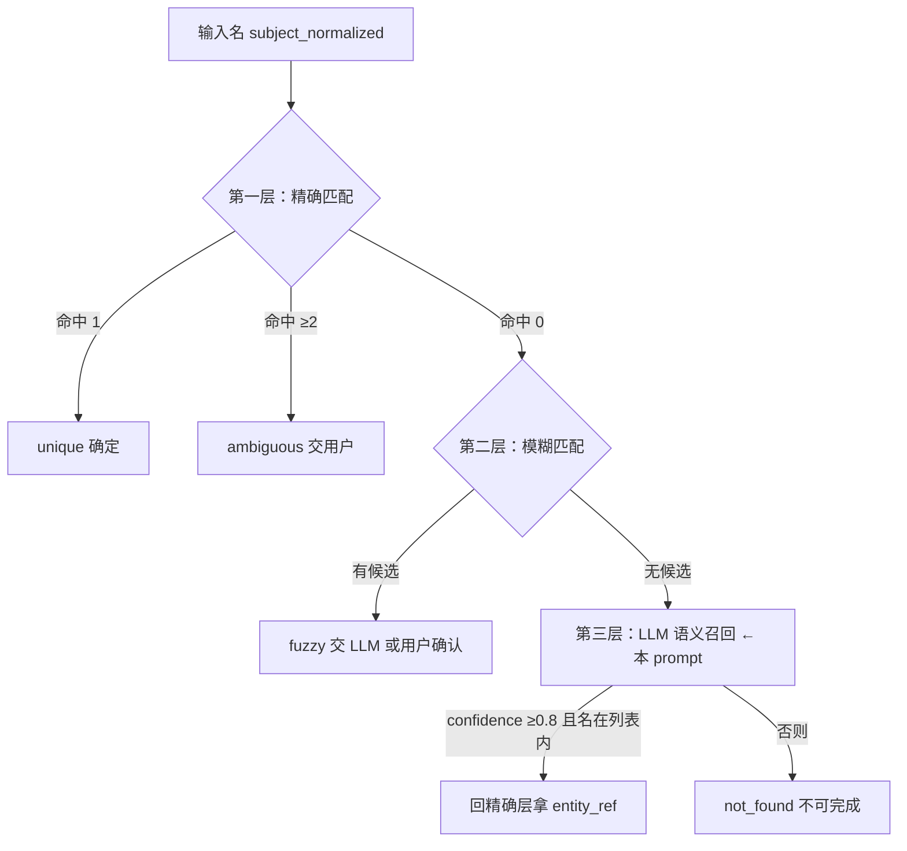

# Prompt 工程 · 解说任务核查（N2 resolve）

> **版本**：v0.1
> **范围**：N2 `resolve` 节点内「名称语义召回」的 System Prompt / User Prompt 模板
> **上游约束**：遵循《03-核心图设计_解说词生成.md》§2.2 N2（名称消歧 + 可完成性预检）
> **下游产出**：`NameSemanticMatch`（matched / matched_name / confidence / reason），用于把「模糊输入名」锚定到索引内真实实体
> **实现**：`work_test/scripts/narration_resolve_simple.py`

---

## 0. 定位

N2 `resolve` 节点职责分两块，**只有「名称语义召回兜底」这一处调 LLM**：

| 子步骤 | 调 LLM? | 说明 |
|---|---|---|
| ① 名称消歧·精确匹配 | ❌ | NFKC 归一后比 `normalized_name` + 所有 `surface`/`alias`，纯查表 |
| ① 名称消歧·模糊匹配 | ❌ | difflib 子串 + 相似度（threshold≈0.6），纯确定性 |
| ① 名称消歧·语义召回 | ✅ | **仅前两层都 miss 才触发**，单次直调（不起 ReAct、不给工具） |
| ② 覆盖支撑性 | ❌ | 逐分片查 coverage.json `topics` 状态，纯查表 |
| ③ 范围对界 | ❌ | `focus_ranges.to` vs `published_through`，纯数值比较 |
| ④ 汇总可行性 | ❌ | 规则聚合 `ok / degraded / not_feasible / ambiguous` |

本节只覆盖「名称语义召回」这一处 Prompt；②③④ 是确定性逻辑，**不在此文档范围**（详见 §0.3）。

### 0.1 核心设计：LLM 只做「召回消歧」，绝不做「存在性裁决」

这是本 prompt 的灵魂，也是与 N1 parse「名称类歧义一律 delegated」契约的衔接点：

- parse 阶段拿不准的别名/简称/多候选 → 丢 `unresolved_placeholders`，`disposition=delegated`；
- resolve 阶段先做**确定性精确/模糊匹配**（不花 token、不会幻觉）；
- 只有前两层全 miss 时，才让 LLM **从代码拉出的真实候选列表里挑一个**。

> **关键约束**：「存在性」是客观事实，LLM 只负责「从真实候选里挑」，**不负责回答「存在吗」**——因为让 LLM 凭空回答「存不存在」必然诱发幻觉编造 ref。候选列表由代码从 `names/*` 索引拉出，LLM 的输入本身就是「真实存在的全部名字」，从而把幻觉空间压缩到「挑错」而非「编造」。

### 0.2 三层递进触发条件



**本 prompt 只在 G 节点触发**，是罕见兜底路径；正常情况 90% 走确定性层，不产生 token 成本。

### 0.3 为什么②③④不交给 LLM

- **覆盖状态是确定性枚举**（`complete/partial/stale/not_analyzed/no_findings`），是规则不是「灵活判断」；
- LLM 读结构化数据易读错、费 token，且可能幻觉「可生成」而实际无材料；
- 数值对界更是纯比较，交给 LLM 纯属浪费。

### 0.4 Prompt 缓存约束

`RESOLVE_NAME_SYSTEM` 是**模块级常量，禁止任何 f-string / 占位符插值**，保证前缀缓存稳定；唯一动态变量（待匹配名 + 候选列表）只进 User 段。约定同《04-prompt_解说任务优化.md》§0.3。

---

## 1. 结构化输出 Schema

LLM 通过 `with_structured_output(NameSemanticMatch)` 强制产出结构化结果（失败退回文本 JSON 提取，最终兜底 `matched=false`）。

| 字段 | 类型 | 说明 |
|---|---|---|
| `matched` | bool | 是否命中（默认 false，保守） |
| `matched_name` | str \| null | 命中的名字，**必须是候选列表里的名字**，禁止编造 |
| `confidence` | float | 0~1，表示「输入名与候选名指代同一人的把握」，< 0.8 视为 no_match |
| `reason` | str | 判定理由 |

---

## 2. System Prompt

````text
你是「名称语义召回员」。你的唯一任务：在给定的**候选名字列表**中，找出与用户输入最可能指代同一个人的那个名字。

## 铁律（违反即失败）

1. **候选列表是唯一事实来源**。你只能从列表里挑一个名字返回，**严禁**输出列表之外的名字、严禁补充你「记得」的角色名。
2. **不做存在性裁决**。列表里没有相似名字时，必须返回 `matched=false`，即使你确信现实/小说里有这么个人。列表里没有就是没有。
3. **置信度诚实**。`confidence` 表示「输入名与候选名指代同一人的把握」。把握不足（< 0.8）必须返回 `matched=false`，不要硬凑。
4. **只输出一个最优匹配**，不要返回多个候选。

## 判断要点

- 常见别名/简称/绰号/错别字：如「猴子」「猴哥」「孙行者」可能都指「孙悟空」。
- 只凭「读音相近」或「单字相同」不足以匹配，需整体语义上确实指同一人。
- 拿不准时宁可 `matched=false`，也不要误匹配——误匹配会把下游解说导向错误人物，代价远大于漏匹配。

## 输出

必须调用提交工具，以 `NameSemanticMatch` 的 schema 输出结构化结果。
````

---

## 3. User Prompt 模板

````text
【待匹配输入名】{name}

【候选名字列表（真实存在于索引中，只能从这里选）】
- {candidate_1}
- {candidate_2}
- ...

请判断输入名与列表中哪个名字最可能指同一人，并按 schema 输出。
````

> `{candidate_*}` 由 `_collect_surfaces(name_entries)` 从索引拉出（`normalized_name` + 所有 `surface`/`alias` 去重归一），**LLM 只能从这些真实名字里挑**。

---

## 4. 候选池来源（关键：代码负责「真实性」，LLM 负责「挑选」）

| 环节 | 负责方 | 说明 |
|---|---|---|
| 拉出候选列表 | 代码 | `manifest.name_index_ref → names/index.json → shard_refs → part-*.json`，收集所有 `normalized_name` + `matches[].surface` |
| 归一去重 | 代码 | NFKC + 去首尾空白 + 去重 |
| 从候选中挑最优 | LLM | 只做「召回消歧」 |
| 回精确层拿实体 | 代码 | LLM 命中后，用 `matched_name` 回 `resolve_name_exact` 拿 `entity_ref` |

**好处**：即使 LLM 幻觉输出一个列表外名字，也拿不到实体——代码侧有第二道闸（见 §5）。

---

## 5. 代码侧兜底（两道闸）

1. **列表外名字强制 no_match**：LLM 返回的 `matched_name` 若不在候选列表内，代码直接改写为 `matched=false`，并记录 reason。
2. **结构化输出失败保守兜底**：`with_structured_output` 与 JSON 提取均失败时，返回 `matched=false`（保守判定，宁可漏匹配不可误匹配）。

> ⚠️ **已知缺口**：`confidence < 0.8` 目前仅靠 Prompt 软约束，**代码未硬校验**。即 LLM 若返回 `matched=true + confidence=0.5 + 合法名字`，代码会放行。是否需要在代码侧补硬校验，见 §7 待办。

---

## 6. 禁止事项

- ❌ 输出候选列表之外的名字（唯一事实来源是列表）
- ❌ 凭外部知识补充「记得」的角色名
- ❌ 回答「这个人存在吗」——存在性由索引客观决定，你只负责挑
- ❌ 硬凑低置信度匹配（< 0.8 必须 no_match）
- ❌ 返回多个候选（只输出一个最优匹配）
- ❌ 输出自由命名的 JSON 文本（必须用提交工具 schema）

---

## 7. 待办

- [ ] **confidence 硬校验缺口**：代码侧未校验 `confidence < 0.8`，是否补一道硬闸（与「列表外名字强制 no_match」对齐），避免 LLM 软约束失效
- [ ] **模糊匹配阈值调参**：设计文档写 `threshold≈0.85`，但中文 2~4 字名在 0.85 下几乎全 miss（「孙五空」vs「孙悟空」ratio 仅 0.667），代码已默认 0.6；需按真实索引数据回归确认，并回写设计文档
- [ ] 与 N1 parse 的 `unresolved_placeholders`（delegated）契约联调验证：parse 丢出的占位名能否稳定走通本召回路径
- [ ] 语义召回命中后走 `fuzzy` 分支并记「建议下游复核」gap 的合理性确认（当前语义命中一律视为需复核，是否过保守）