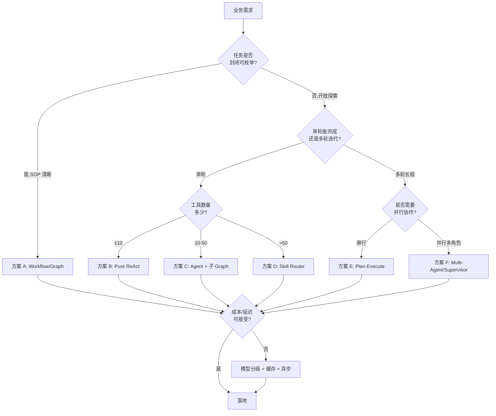
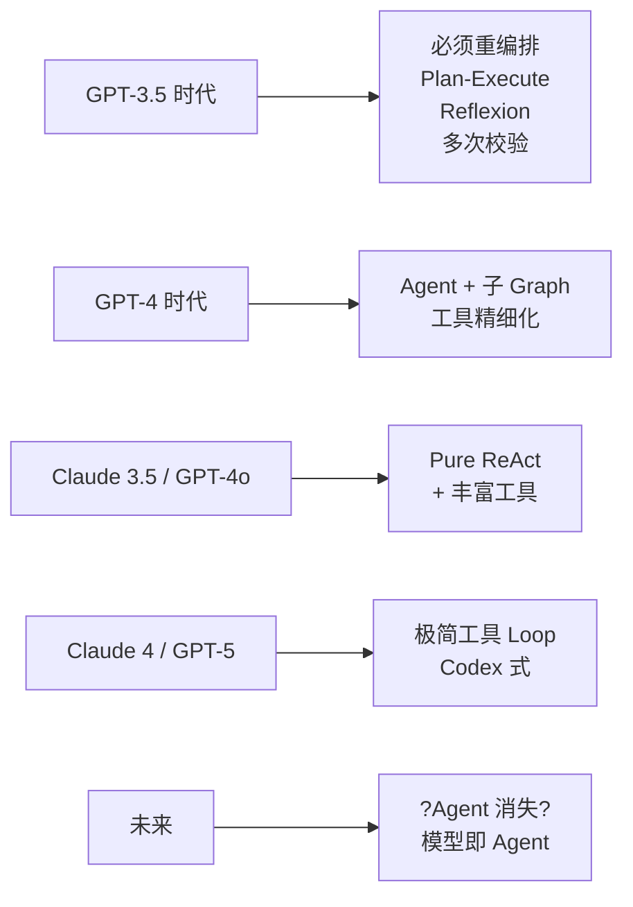
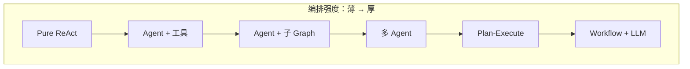
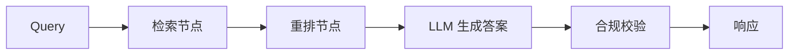
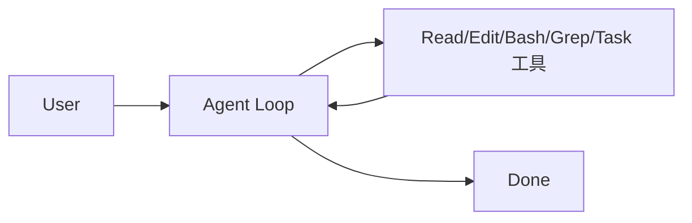
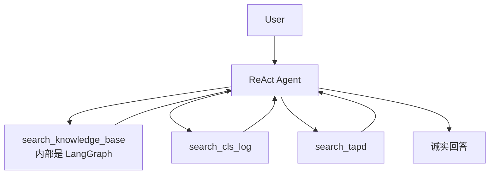
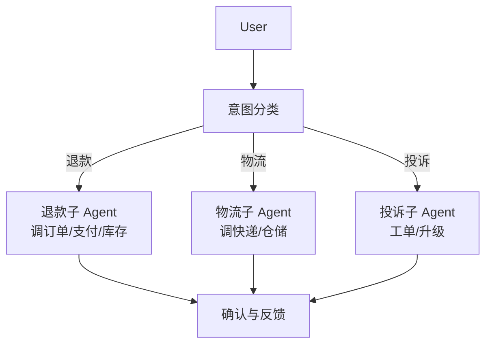
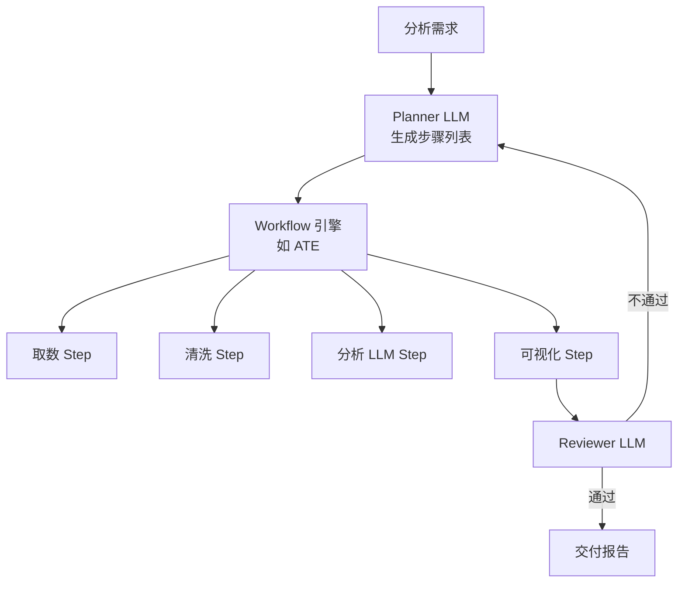
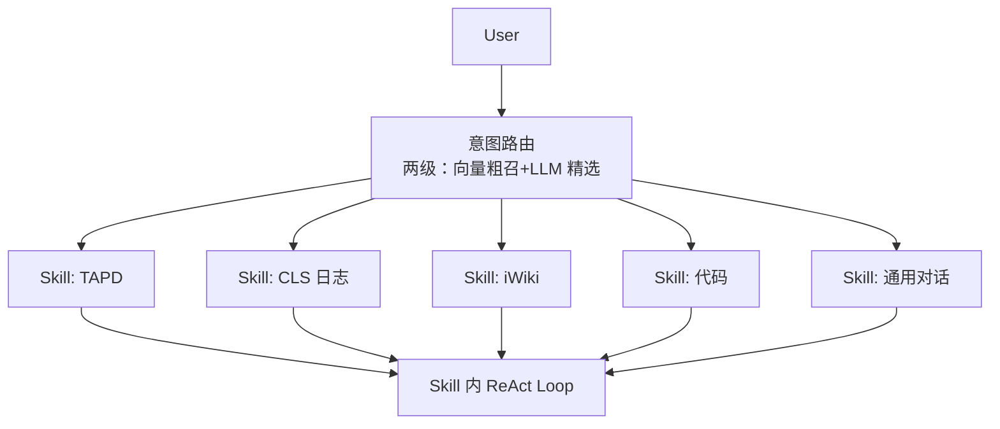

[任务规划完成]
# 如何为业务场景选择 Agent 编排方案：决策框架与案例分析

这是一个工程决策问题，不是技术选型问题。下面从**决策流程 → 评估维度 → 现有方案映射 → 场景案例**四层展开。

---

## 一、核心决策流程（五步法）



**五步决策**：

1. **刻画任务形态** → 封闭 vs 开放？单轮 vs 多轮？串行 vs 并行？
2. **估算工具规模** → 工具数决定是否需要路由
3. **选择编排骨架** → 匹配上图六个方案
4. **压力测试成本** → 延迟/token/并发是否达标
5. **预留演进空间** → 模型变强后是否需要降级编排复杂度

---

## 二、必须考虑的 8 个维度

### 2.1 功能性维度（决定"能不能做"）

| 维度 | 问题 | 影响 |
|---|---|---|
| **任务可预测性** | 流程是否可提前画出 DAG？ | 决定用 Graph 还是 ReAct |
| **工具数量** | 10 / 50 / 500？ | 决定是否要路由层 |
| **任务时长** | 秒级 / 分钟级 / 小时级？ | 决定是否要 checkpoint + 异步 |
| **并行需求** | 子任务能否并发？ | 决定是否要 fan-out/supervisor |
| **HITL 粒度** | 需要人工介入几次？在哪里？ | 决定 interrupt 点位设计 |

### 2.2 非功能性维度（决定"值不值得做"）

| 维度 | 问题 | 关键权衡 |
|---|---|---|
| **成本** | 每次交互 token 消耗？ | 重编排省 token，薄编排省工程 |
| **延迟** | p50/p99 要求？ | ReAct 多轮延迟高，Graph 延迟稳 |
| **可靠性** | 失败率要求？是否可审计？ | Graph 可审计，Agent 需日志 trace |
| **演进速度** | 需求迭代节奏？ | Prompt 迭代快，代码编排迭代慢 |
| **模型演进** | 当前靠 GPT-4，未来靠 GPT-6？ | 编排越薄越能"吃到"模型红利 |

---

## 三、必须认真考虑成本与模型演进（重点）

### 3.1 成本结构拆解

一次 Agent 调用的总成本：

```
Total Cost = Σ(每轮 LLM 调用 × 单价) 
           + 工具执行成本（搜索/数据库/API）
           + 工程维护成本（编排代码/Prompt 调优）
           + 失败重试成本
```

**关键认知**：

| 编排方式 | LLM 轮次 | 单轮 Token | 工程成本 | 适合经济学 |
|---|---|---|---|---|
| Pure ReAct | **高**（3-10 轮） | 低（工具少时） | 低 | 低频高价值查询 |
| Agent + Graph | 中 | 中 | 高 | 中频中价值 |
| Workflow + LLM Step | **低**（固定点位） | 高（上下文全） | 中 | 高频 SOP |
| Multi-Agent | **很高**（多个 Agent 各自循环） | 高 | 很高 | 高价值长程任务 |

**举个具体例子**：
- 简单 FAQ 查询，用 Pure ReAct：3 轮 × 2K token = 6K，但响应慢（~15 秒）
- 同样问题，用 Workflow：1 轮 × 5K token = 5K，响应快（~5 秒）
- → **高频场景优选 Workflow**，省钱又省延迟

### 3.2 模型演进必须纳入架构考量

这是**最容易被忽视但影响最深远**的因素。



**核心规律**：**模型越强，编排越薄**。

这意味着：

1. **过度编排是一种技术债**
   - 你今天用 LangGraph 搭了 20 个节点的 pipeline，一年后用 GPT-5 可能一个 Prompt 就搞定
   - 当年用 ReAct + 10 层 Prompt 技巧的早期 Agent，现在都在往 Pure Loop 迁移

2. **编排层要"可剥离"**
   - 把编排逻辑放在**可替换的中间层**，不要让业务代码直接依赖 Graph 结构
   - 你的 SuperMew 做得不错：工具层（[knowledge.py](/Users/wickfu/code/cls-ai/SuperMew/backend/tools/knowledge.py)）通过 `@tool` 协议解耦，RAG 内部换实现不影响 Agent

3. **工具契约比编排更稳定**
   - 工具是"业务原语"，模型升级后依然需要
   - 编排是"模型的拐杖"，模型变强后可能被扔掉
   - **投资工具生态，而非编排框架**

### 3.3 成本/演进的决策矩阵

| 场景特征 | 推荐方向 | 理由 |
|---|---|---|
| 高频 + 低价值（如 FAQ） | 轻编排 + 强缓存 | 省钱比准确重要 |
| 低频 + 高价值（如代码生成） | 丰富工具 + 薄编排 | 吃模型红利 |
| 高频 + 高价值（如客服主流程） | Workflow + LLM 嵌入 | 稳定可控 |
| 低频 + 低价值（如内部工具） | 直接用 Pure ReAct | 不投入 |

---

## 四、现有编排方案全景（6 大类）



| # | 方案 | 代表 | 核心思想 | 一句话定位 |
|---|---|---|---|---|
| **1** | Pure ReAct | Claude Code / Codex | 单循环 + 丰富工具 | 信任模型，极简派 |
| **2** | Agent-over-Graph | **你的 SuperMew** | 上层 Agent 决策，下层 Graph 执行 | 稳健派 |
| **3** | Graph-over-Agent | LangGraph Supervisor | 外层固定 DAG，节点内 Agent | 流水线派 |
| **4** | Multi-Agent / Supervisor | AutoGen / Swarm | 多个专家 Agent 协作 | 分工派 |
| **5** | Plan-Execute | Devin / BabyAGI | 先规划再执行 | 长程派 |
| **6** | Workflow + LLM | Temporal / ATE + LLM | 流程引擎驱动，LLM 当 Step | 企业派 |

---

## 五、业务场景实战案例（6 个场景 → 6 个方案）

### 案例 1：企业内部 FAQ 问答（如"报销流程是什么？"）

**特征**：
- 问题相对封闭，答案在知识库里
- 用户量大、要求快速响应
- 容错率低（答错会被投诉）

**选型**：**Workflow + LLM Step（方案 6）**



**理由**：
- 流程完全确定，LLM 只负责"写答案"这一步
- 延迟可控（<3 秒）
- 可审计（每步都能回放）
- **不需要 Agent 决策**

**成本**：每次 ~3K token，秒级响应 → 适合高频

---

### 案例 2：代码助手（如 Claude Code / Cursor）

**特征**：
- 任务极度开放（写 bug / 改需求 / 跑测试 / 查文档都要能做）
- 用户是开发者，容忍多轮交互
- 工具种类有限但组合千变万化

**选型**：**Pure ReAct（方案 1）**



**理由**：
- 编排越薄越能吃到模型升级红利
- 工具粒度细，组合空间大，不需要外部编排
- `TodoWrite` 这类"外置规划工具"替代 Planner

**成本**：单次任务可能 100K+ token，但价值高（节省开发者 30 分钟 = 几百块人力）→ **可承受**

---

### 案例 3：日志排障助手（你 SuperMew 的典型场景）

**特征**：
- 用户问题常常模糊（"我的服务为什么慢？"）
- 需要在知识库 + CLS 日志 + TAPD + 代码 之间横跳
- RAG 本身很复杂（分类、改写、HITL）
- 容错中等（答错不致命，但要诚实）

**选型**：**Agent-over-Graph（方案 2）** ← 你当前的方案



**理由**：
- RAG 这类**本身就复杂**的子任务用 Graph 封装（分类/改写/HITL）
- 上层 Agent 决策"要不要查、查几次、查哪里"
- 工具间组合由 LLM 决定，灵活性保留

**你项目正是这种选择的教科书**：
- [knowledge.py](/Users/wickfu/code/cls-ai/SuperMew/backend/tools/knowledge.py) 的 `_render_rag_result` 用字符串前缀协议把 Graph 状态压扁给 Agent，正是这种编排的精髓
- 让 Agent 可以根据 `NEEDS_CLARIFICATION` / `PARTIAL_EVIDENCE` 等信号自己决定下一步

---

### 案例 4：客服 Agent（如电商售后）

**特征**：
- 对话多轮，意图分支多（退款/物流/投诉/咨询）
- 不同意图触发完全不同的流程
- 需要调用大量业务系统
- 合规要求高（必须有审计）

**选型**：**Graph-over-Agent（方案 3）或 Multi-Agent（方案 4）**



**理由**：
- 外层 DAG 保证主流程可审计（合规必须）
- 每个子 Agent 领域专精、工具隔离
- 可以 A/B 测试单个 Agent 不影响全局

---

### 案例 5：数据分析师助手（如"分析上月销售数据并出报告"）

**特征**：
- 长程任务（分钟到小时）
- 步骤多且需要串行依赖（取数 → 清洗 → 分析 → 可视化 → 结论）
- 中间失败需要重试
- 结果需要人工 review

**选型**：**Plan-Execute（方案 5）+ Workflow 落地（方案 6 混合）**



**理由**：
- 规划一次性产出，减少 LLM 调用
- 执行走工作流引擎，支持断点续跑/重试/异步
- Reviewer 做最后把关
- **你项目的 `ate-flow-builder` Skill 正是为这种场景设计的**

---

### 案例 6：通用工作助手（WorkBuddy / 企业大助手）

**特征**：
- 工具数量数百到数千（MCP 时代）
- 用户群体广，场景极度分散
- 每个场景深度一般（不像代码助手那么深）

**选型**：**Skill Router + Pure ReAct 混合（方案 1 + 4 的变体）**



**理由**：
- 工具太多，必须用 Router 控制 Prompt 长度
- 每个 Skill 内部用轻量 ReAct，保持灵活
- Skill 之间松耦合，可独立演进
- 你当前上下文里的 TAPD/CLS MCP 工具就是这种架构

---

## 六、决策检查清单（Checklist）

在做选型前，逐项回答：

### 📋 任务特性
- [ ] 流程是否可提前画出 DAG？（Yes → Graph；No → Agent）
- [ ] 任务是否 >1 分钟？（Yes → 需要 checkpoint）
- [ ] 子任务可并行吗？（Yes → fan-out / multi-agent）
- [ ] HITL 需要几次？在哪？

### 📋 规模评估
- [ ] 工具数量：___ 个
- [ ] 预期 QPS：___
- [ ] 单次响应预算：___ 秒
- [ ] 单次 token 预算：___ K

### 📋 成本权衡
- [ ] 是否高频？（高频 → 轻编排 + 缓存）
- [ ] 是否高价值？（高价值 → 允许重编排）
- [ ] 模型分级策略？（强模型做决策，弱模型做执行）

### 📋 演进性
- [ ] 工具契约是否稳定？
- [ ] 编排层是否可替换？
- [ ] 2 年后模型变强，架构是否能"降级"（去掉冗余编排）？

### 📋 工程性
- [ ] 团队熟悉哪些框架？
- [ ] 是否需要可观测/可审计？
- [ ] 失败回滚策略？

---

## 七、三条经验法则

### 法则 1：**从最薄的编排开始**

- 先用 Pure ReAct 跑通
- 遇到问题再加编排（限流 → 中间件；多步失败 → 子 Graph；工具太多 → Router）
- **不要一开始就上 LangGraph** —— 大概率过度工程

### 法则 2：**编排复杂度与模型能力成反比**

- 这是最重要的一条
- 预留"降级空间"，让架构可以随模型变强而变薄
- 投资工具 > 投资编排

### 法则 3：**不同层用不同范式**

- 外层入口（Router / Workflow）追求**稳定可控**
- 中间 Agent 追求**灵活决策**
- 底层工具追求**原子可组合**
- 不要试图用一种范式解决所有问题

---

## 八、你 SuperMew 项目的位置

从你的代码看，当前选择非常合理：

```
业务特征：日志排障 + 知识问答（中频中价值 + 复杂 RAG + 多轮对话）
         ↓
选型：Agent-over-Graph
         ↓
实现：ReAct（factory.py）+ RAG StateGraph（pipeline.py）+ 协议桥（knowledge.py）
         ↓
优势：既保留开放决策，又把复杂 RAG 封装成稳定工具
```

**可继续优化方向**（按优先级）：

1. **先加 `TodoWrite` 式工具** → 低成本提升多轮任务可观测性
2. **再做工具路由** → 当 MCP 工具数超过 30 个时启动
3. **最后考虑 Plan-Execute** → 当出现"分析 + 报告"类长程任务时启动

**不建议**：
- ❌ 现在就拆成 Multi-Agent（场景没分化到那个程度）
- ❌ 把 RAG 从 Graph 退化成 Pure ReAct（RAG 复杂度真实存在）

---

## 核心结论

> **选编排不是选框架，而是选"把复杂度放在哪一层"的策略：**
> 
> - 放在**模型**（Pure ReAct）：灵活，吃模型红利，但不稳定
> - 放在**代码**（Workflow/Graph）：稳定可审计，但僵化、不吃红利
> - 放在**工具**（丰富 Tools）：**最推荐**，模型升级依然受益
> - 放在**Prompt**（指令+规则文件）：迭代快，但难审计
> 
> **成熟的 Agent 系统往往是四者组合**——根据业务不同层次的要求，把复杂度放到合适的地方。

