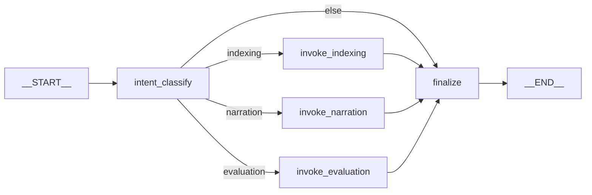
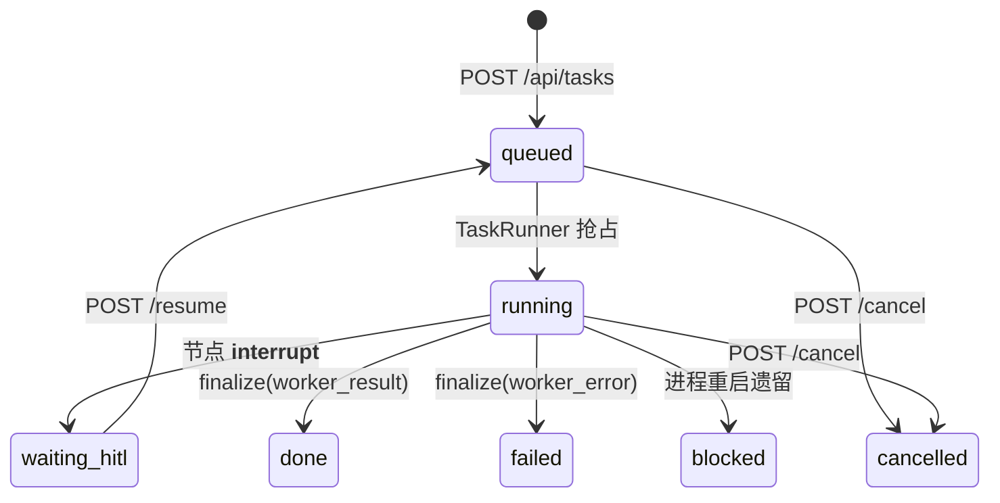

[任务规划完成]
我来帮你分析这个项目的异步任务框架实现。先了解一下项目结构。
[查找目录]
我重点关注 `runtime/` 目录，这里包含 Orchestrator、Runner、Middlewares、Workers 等核心异步任务组件。并行读取关键文件：
[读取文件]
再看一下任务入队的 Gateway 入口和 SSE 事件流，以及 Task 表模型，这样可以完整描述整个异步任务生命周期：
[读取文件]
信息已经非常充分，可以为用户全面梳理该项目的异步任务框架实现。

---

# novel-flow 异步任务框架实现剖析

该项目是一个**仿 DeerFlow 架构**的单机单用户版 Agent 系统。它并没有引入 Celery / RQ 这类外部任务队列，而是基于 **FastAPI 异步生命周期 + SQLite 数据库作为任务队列 + 自实现的 LangGraph 兼容 StateGraph** 来构建一套"轻量级异步任务执行引擎"。

整体可以用一句话概括：

> **FastAPI 启动时拉起一个 `TaskRunner` 协程池，不断从 `tasks` 表轮询 `queued` 任务，交给 `Orchestrator` LangGraph 图去跑；节点间通过"入口/出口中间件"注入沙箱与 Checkpoint；HITL 用 interrupt 机制挂起，通过 REST 恢复入队；运行事件实时通过 SSE 推送给前端。**

下面按**生命周期 / 执行引擎 / 持久化队列 / HITL / 可观测性**五个维度展开。

---

## 1. 组件总览与数据流

```mermaid
flowchart LR
  subgraph FE[前端]
    UI[React/Vite]
  end
  subgraph GW[Gateway 层]
    R1[POST /api/tasks<br/>入队]
    R2[GET  /api/tasks/:id/stream<br/>SSE]
    R3[POST /api/tasks/:id/resume<br/>HITL恢复]
  end
  subgraph DB[(SQLite)]
    T[tasks 表<br/>status=queued/running/<br/>waiting_hitl/done/...]
  end
  subgraph RT[Runtime]
    RUN[TaskRunner<br/>N 个 worker 协程]
    ORCH[Orchestrator<br/>StateGraph]
    W1[IndexingWorker]
    W2[NarrationWorker]
    MW[Middlewares<br/>ThreadData/Sandbox<br/>Checkpoint/Clarification]
  end
  BUS((EventBus<br/>per-task asyncio.Queue))

  UI -- 提交 --> R1 --> T
  RUN -- 轮询 pick --> T
  RUN --> ORCH --> W1 & W2
  ORCH -. 包装 .- MW
  ORCH -- publish --> BUS
  R2 -- subscribe --> BUS -- SSE --> UI
  UI -- confirmed --> R3 --> T
```

---

## 2. 启动与生命周期：FastAPI `lifespan`

见 [app.py](/Users/wickfu/code/cls-ai/deer-flow/xianni_test/novel_flow/backend/app/gateway/app.py) 的 `lifespan`：

启动阶段按序完成 5 件事：

1. `setup_logging()` 初始化日志
2. `run_migrations()` 自动跑 Alembic 迁移
3. 启动 `Tracer`（必须在 Worker 之前，保证 span 能被 flush）
4. `_recover_running_tasks()`：**崩溃恢复**。把残留的 `running` 任务置为 `blocked`，避免永久挂起（真正的 checkpoint 续跑在 M3 后由 Orchestrator 实现）
5. `get_mcp_manager().startup()` + `get_task_runner().start()` 启动任务消费器

关停阶段反向：`runner.stop()` → `mcp.shutdown()` → `tracer.stop()` → `close_engine()`。

---

## 3. 异步任务队列：以 SQLite 为"持久化队列"

本项目没有用 Redis/Celery，而是**把 `tasks` 表当队列**用，由 `TaskRunner` 轮询消费。

### 3.1 入队：`POST /api/tasks`

在 [tasks.py](/Users/wickfu/code/cls-ai/deer-flow/xianni_test/novel_flow/backend/app/gateway/routers/tasks.py) 的 `submit_task` 中：

- 生成 `task_id`、`trace_id`
- 向 `tasks` 表插入一行：`status="queued"`，`payload` 保存用户请求参数
- 立即返回 `202 Accepted` + `task_id`

### 3.2 消费：`TaskRunner`

[runner.py](/Users/wickfu/code/cls-ai/deer-flow/xianni_test/novel_flow/backend/app/runtime/runner.py) 中的核心点：

- **并发度** `concurrency=2`，启动 N 个 `asyncio.Task` 作为 worker 协程循环
- `_worker_loop`：无限循环 `_pick_task` → `_run_one`，失败 sleep 2s 后继续
- `_pick_task` 的"抢占"做法（SQLite 单文件无 `SELECT ... FOR UPDATE SKIP LOCKED`）：
  1. `SELECT ... WHERE status='queued' ORDER BY priority DESC, created_at LIMIT 1`
  2. 立刻 `UPDATE ... WHERE id=? AND status='queued' SET status='running'`
  3. 通过 `rowcount==0` 判断是否被别的 worker 抢走，若被抢走则放弃
- `_run_one` 负责：
  - 构造初始 `OrchestratorState`（含 `task_id / novel_id / payload / budget / trace_id`）
  - 发布 `task.start` SSE 事件
  - 调用 `graph.ainvoke(initial_state, config={"configurable": {"thread_id": task_id}}, resume_from=...)`
  - 异常兜底：抛出未捕获异常时直接把 task 标为 `failed`

> 轮询间隔 `poll_interval=1.0s`，适合单机场景；并发度由配置决定。

---

## 4. 执行引擎：自实现的 LangGraph 兼容层

[graph.py](/Users/wickfu/code/cls-ai/deer-flow/xianni_test/novel_flow/backend/app/runtime/graph.py) 实现了一个**与 LangGraph API 兼容的极简 StateGraph**，不强依赖 langgraph 包：

- `StateGraph`：`add_node / add_edge / add_conditional_edges / set_entry_point / compile`
- `_CompiledGraph.ainvoke`：
  - 维护 `thread_id → thread_states` 的回放列表
  - 执行循环：解析下一节点 → 跑节点协程 → `state.update(result)` → 继续
  - 支持 `__interrupt__` 信号：节点返回 `{"__interrupt__": payload}` 时，保存 `(next_node, state)` 到 `self.interrupts[thread_id]`，并额外跑一次 `finalize` 节点落库，然后返回当前 state
  - 支持 `resume_from`：恢复时直接从 `interrupts` 弹出保存状态，塞入 `state["hitl_response"]` 并从被中断的节点继续

### 4.1 Orchestrator Graph 结构

[orchestrator.py](/Users/wickfu/code/cls-ai/deer-flow/xianni_test/novel_flow/backend/app/runtime/orchestrator.py) 中的 `build_orchestrator_graph`：



- `intent_classify`：从 `task_payload.task_type` 解析任务类型（纯结构化，不走 LLM）
- `invoke_*`：动态 import 对应 Worker 子图 `run_*_worker`，不存在就返回 `NOT_IMPLEMENTED` 占位
- `finalize`：根据 `worker_error / pending_hitl / worker_result` 决定最终 status 为 `done / failed / waiting_hitl`，把结果写回 `tasks` 表并通过 EventBus 发送 `task.done / task.failed / hitl` 事件

### 4.2 节点统一包装：`_wrap_middleware`

**非常关键的切面**，所有节点都被包成同一个外壳，统一完成：

```text
entry 中间件 → 设置 Trace 上下文 → 发 node.start SSE
→ span("node.xxx") 上下文
   → 执行节点函数
   → 捕获 NovelFlowError（业务异常，转 worker_error）
   → 捕获其他 Exception（兜底 INTERNAL）
→ 若返回 __interrupt__：透传 + exit 中间件 + 发 node.end(interrupt=true)
→ 否则：exit 中间件 + 发 node.end
```

这保证**任何节点都有一致的可观测性与异常兜底**。

---

## 5. 中间件链（节点级 AOP）

[middlewares/\_\_init\_\_.py](/Users/wickfu/code/cls-ai/deer-flow/xianni_test/novel_flow/backend/app/runtime/middlewares/__init__.py) 实现了 4 条中间件，但**不是用 LangGraph 内部 middleware API**，而是用自定义的"节点前置/后置钩子"模式：

| 中间件 | 时机 | 作用 |
| --- | --- | --- |
| `ThreadDataMiddleware` | entry | 向 state 注入 `sandbox_mount`（LLM 用的虚拟路径） |
| `SandboxMiddleware` | entry | 构造 `NovelSandbox` 实例挂到 `RuntimeContext.sandbox`（**不可序列化对象不进 state**） |
| `CheckpointMiddleware` | exit | 节点结束后更新 `tasks.last_checkpoint_id + updated_at` |
| `ClarificationMiddleware` | 节点内按需 | 把工具检测到的"澄清需求"写入 `state["pending_hitl"]`，返回 True 表示应触发 interrupt |

通过 `apply_entry_middlewares` / `apply_exit_middlewares` 两个统一入口聚合调用。

> `RuntimeContext` 是**不进 state 的旁路对象**，用来传 Sandbox 这类不可序列化实例，这是 LangGraph State 必须是 TypedDict/可序列化这个约束下常见的设计模式。

---

## 6. 任务状态机

Task 的生命周期：



与之对应的字段：`status / priority / payload / last_checkpoint_id / token_used / started_at / finished_at`（见 [models.py](/Users/wickfu/code/cls-ai/deer-flow/xianni_test/novel_flow/backend/app/storage/models.py) 的 `Task`）。

---

## 7. HITL（Human-in-the-Loop）

典型的"interrupt + resume"模式：

1. **挂起**：Worker 节点内部检测到需要用户确认（如 `IndexingWorker` 骨架评审），直接 `return interrupt_signal({...})`，即 `{"__interrupt__": payload}`
2. **引擎捕获**：`_CompiledGraph.ainvoke` 发现返回值含 `__interrupt__`：
   - 把 `(next_node=当前节点, state)` 保存到 `self.interrupts[thread_id]`
   - 额外跑一次 `finalize` 把 `status=waiting_hitl` 落库并通过 SSE 推 `hitl` 事件
   - 返回当前 state 结束本次 `ainvoke`
3. **用户响应**：前端 `POST /api/tasks/{id}/resume` 带 `response`：
   - 把 `response` 写进 `task.payload["__resume__"]`
   - 把 `status` 改回 `queued`
4. **恢复执行**：TaskRunner 下一次轮询会再次抢占这条任务，调用 `graph.ainvoke(..., resume_from=payload["__resume__"])`
5. 引擎检查到 `interrupts[thread_id]` 存在且 `resume_from` 非空，就从被中断节点原地续跑，并把用户输入塞到 `state["hitl_response"]`

> 优点：**不依赖长连接保持运行上下文**，中间甚至可以重启进程（只要图状态能从 payload 复原即可）。当前实现是**内存级 interrupts dict**，重启会丢失，这也是 README 中 "M3 之后用 checkpoint 续跑" 的 TODO。

---

## 8. SSE 实时推送：EventBus

[sse.py](/Users/wickfu/code/cls-ai/deer-flow/xianni_test/novel_flow/backend/app/gateway/sse.py) 的 `EventBus` 是一个**per-task 的内存事件总线**：

- `_queues: dict[task_id, list[asyncio.Queue]]`：一个 task 可被多订阅
- `publish(task_id, event)`：遍历所有订阅者 `put_nowait`，队列满直接 drop + 告警日志
- `subscribe(task_id)`：挂一个新 `asyncio.Queue`，async for 吐出 `Event`；收到 `None` 则结束迭代
- `close(task_id)`：发送终结 `end` 事件 + 入 None 结束符

对应的 HTTP 端点 `/api/tasks/{task_id}/stream` 返回 `StreamingResponse(media_type="text/event-stream")`，循环把 `Event.to_payload()` 格式化为 `data: ...\n\n`。

事件类型包括：`task.start / node.start / node.end / token / hitl / progress / critic_score / task.done / task.failed / end` 等。

---

## 9. 可观测性与并发资源

- **Trace**：每个节点在 `_wrap_middleware` 中用 `span(f"node.{name}", kind="node")` 包起来，Tracer 异步 flush 到 `spans` 表；`/api/tasks/{id}/trace` 可拿到完整 span 树
- **Budget**：Runner 构造 `Budget.default_from_settings()` 注入到 state，`finalize` 时从 state 读 `token_used` 落库
- **LLM 调用观测**：`llm_calls` + `llm_cache` 表，由 `LLMGateway` 侧负责写入
- **恢复机制**：进程启动时所有残留 `running` 任务被标 `blocked`，防止永久挂起（当前阶段的保守策略，未来由 LangGraph `AsyncSqliteSaver` + checkpoint 替代）

---

## 10. 设计亮点与权衡

| 设计点 | 优点 | 当前阶段的权衡 |
| --- | --- | --- |
| **SQLite 当队列** | 零外部依赖，单机易部署 | 并发度低（轮询 + 单文件锁），不适合高吞吐 |
| **自实现 StateGraph** | 不强依赖 langgraph 包，便于裁剪 | 没有真正的 checkpoint 持久化，重启丢失挂起态 |
| **节点统一 Wrap**（`_wrap_middleware`） | 异常/事件/trace 统一兜底，节点函数非常干净 | 整体耦合到项目框架，节点难独立测试 |
| **RuntimeContext 旁路** | 把不可序列化对象（Sandbox）隔离出 state | 需要额外约定，容易被遗忘 |
| **HITL = interrupt + resume via payload** | 不需要长连接，REST 风格清晰 | 中断态只在内存，重启需要补 checkpoint |
| **EventBus 内存队列** | 极简 SSE 推送 | 多实例部署需要换成 Redis Pub/Sub |

---

## 一句话总结

**novel-flow 的异步任务框架 = `FastAPI lifespan` 启动的 `TaskRunner` 协程池 + 以 `tasks` 表为持久化队列 + 自实现的 LangGraph 兼容 `StateGraph` 执行 Orchestrator/Worker 图 + 节点级 4 条中间件做 AOP + 内存 `EventBus` 通过 SSE 推事件 + "interrupt/resume via payload" 的 HITL 机制**。

关键源码阅读顺序建议：

1. [app.py](/Users/wickfu/code/cls-ai/deer-flow/xianni_test/novel_flow/backend/app/gateway/app.py)：lifespan 启动流程
2. [runner.py](/Users/wickfu/code/cls-ai/deer-flow/xianni_test/novel_flow/backend/app/runtime/runner.py)：队列消费与 worker 协程
3. [orchestrator.py](/Users/wickfu/code/cls-ai/deer-flow/xianni_test/novel_flow/backend/app/runtime/orchestrator.py)：Graph 搭建、节点包装、`finalize` 落库
4. [graph.py](/Users/wickfu/code/cls-ai/deer-flow/xianni_test/novel_flow/backend/app/runtime/graph.py)：StateGraph 兼容层 + interrupt/resume
5. [middlewares/\_\_init\_\_.py](/Users/wickfu/code/cls-ai/deer-flow/xianni_test/novel_flow/backend/app/runtime/middlewares/__init__.py)：4 条切面
6. [tasks.py](/Users/wickfu/code/cls-ai/deer-flow/xianni_test/novel_flow/backend/app/gateway/routers/tasks.py) + [sse.py](/Users/wickfu/code/cls-ai/deer-flow/xianni_test/novel_flow/backend/app/gateway/sse.py)：对外 REST + SSE


