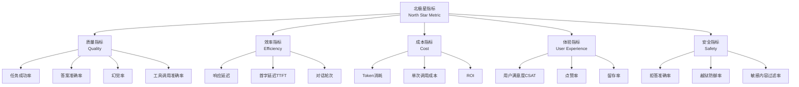
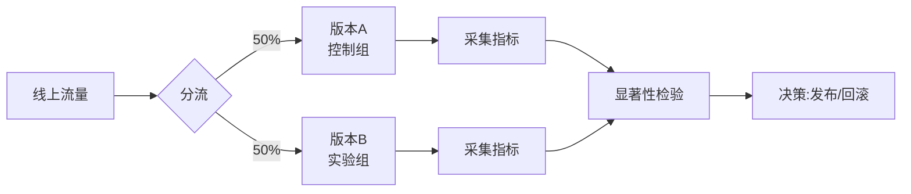
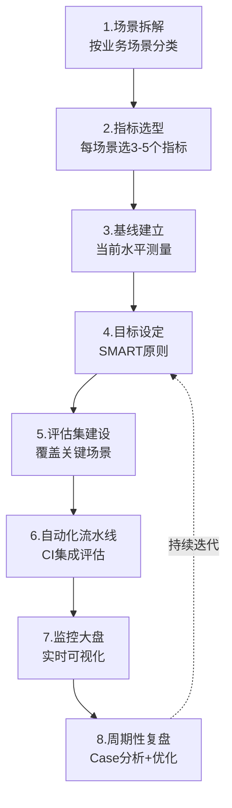

[任务规划完成]
# Agent 成功指标定义详解

成功指标是 Agent 项目的"北极星"，决定了**优化方向、迭代重点、上线标准**。一个科学的指标体系应覆盖**质量、效率、成本、体验、安全**五大维度。

---

## 一、指标体系整体框架



---

## 二、五大维度指标详解

### 1. 质量指标（Quality）—— **最核心**

| 指标 | 定义 | 计算方式 | 判定方法 | 目标值参考 |
|---|---|---|---|---|
| **任务成功率** | 用户目标是否达成 | 完成任务数 / 总请求数 | 人工标注 + LLM-as-Judge | ≥85% |
| **答案准确率** | 回答内容是否正确 | 正确回答数 / 总回答数 | 对照金标集 | ≥90% |
| **答案相关性** | 是否回答了用户问题 | LLM 打分 1~5 | LLM-as-Judge | 平均 ≥4.0 |
| **幻觉率** | 编造信息的比例 | 幻觉回答数 / 总回答数 | 事实性校验 | ≤5% |
| **工具调用准确率** | 是否选对工具 | 正确调用数 / 调用总数 | Trace 分析 + 人工审核 | ≥90% |
| **工具参数准确率** | 工具参数是否正确 | 参数正确数 / 调用总数 | 规则校验 | ≥95% |
| **引用准确率** | RAG 引用是否可靠 | 有效引用 / 总引用 | 对照原文 | ≥85% |
| **多轮一致性** | 多轮对话是否前后一致 | 一致对话 / 多轮对话总数 | 人工评估 | ≥90% |

**判定方法举例**：
- **自动判定**：规则匹配（如必须包含某字段）、单元测试式断言
- **半自动判定**：LLM-as-Judge（用更强的模型给答案打分）
- **人工判定**：标注员按 rubric 评分（金标集建设）

---

### 2. 效率指标（Efficiency）

| 指标 | 定义 | 计算方式 | 判定方法 | 目标值参考 |
|---|---|---|---|---|
| **首字延迟 TTFT** | 首个 token 返回时间 | timestamp(first_token) - timestamp(request) | APM/Trace 采集 | ≤1.5s |
| **总响应时间** | 完整响应生成时间 | timestamp(done) - timestamp(request) | APM/Trace 采集 | P99 ≤10s |
| **工具调用延迟** | 单次工具调用耗时 | 工具 Trace 时长 | 分工具统计 | P95 ≤3s |
| **平均对话轮次** | 完成任务所需轮次 | 总轮次 / 完成任务数 | 会话分析 | ≤3 轮 |
| **一次性解决率** | 单轮即解决问题的比例 | 单轮成功 / 总请求 | 会话分析 | ≥60% |
| **思考步数** | Agent Loop 迭代次数 | ReAct 步数均值 | Trace 统计 | 平均 ≤5 步 |

---

### 3. 成本指标（Cost）

| 指标 | 定义 | 计算方式 | 判定方法 | 目标值参考 |
|---|---|---|---|---|
| **单次调用 Token 数** | 平均每次请求消耗 token | 总 token / 请求数 | 日志统计 | 根据模型定 |
| **单次调用成本** | 平均每次请求花费 | Σ(token × 单价) / 请求数 | 账单核算 | 根据业务定 |
| **月度总成本** | 当月全部花费 | 账单金额 | 账单核算 | 预算内 |
| **成本 ROI** | 投入产出比 | 业务收益 / 成本 | 财务核算 | ≥目标值 |
| **缓存命中率** | Prompt/KV Cache 命中率 | 命中数 / 请求数 | 平台统计 | ≥30% |
| **Token 浪费率** | 无效输出占比 | 无效 token / 总 token | 分析输出质量 | ≤10% |

---

### 4. 用户体验指标（User Experience）

| 指标 | 定义 | 计算方式 | 判定方法 | 目标值参考 |
|---|---|---|---|---|
| **CSAT 满意度** | 用户主观满意度 | Σ评分 / 总评价数 | 问卷/评分（1-5分） | ≥4.0 |
| **点赞率 👍** | 显式正反馈比例 | 👍数 / (👍+👎) | 产品埋点 | ≥80% |
| **投诉率** | 用户投诉比例 | 投诉数 / 总请求 | 工单/反馈 | ≤2% |
| **NPS 净推荐值** | 用户推荐意愿 | %推荐者 - %贬损者 | 定期问卷 | ≥30 |
| **日活/月活** | 使用频次 | DAU / MAU | 埋点统计 | 持续增长 |
| **留存率** | 用户持续使用 | 次日/7日/30日留存 | 埋点统计 | 符合行业基线 |
| **转化率** | 咨询转为业务动作 | 转化数 / 咨询数 | 业务埋点 | 根据场景定 |
| **会话时长** | 用户停留时长 | 总时长 / 会话数 | 埋点统计 | 根据场景定 |

---

### 5. 安全合规指标（Safety）

| 指标 | 定义 | 计算方式 | 判定方法 | 目标值参考 |
|---|---|---|---|---|
| **拒答准确率** | 该拒答时是否拒答 | 正确拒答 / 应拒答总数 | 红队测试集 | ≥95% |
| **误拒率** | 不该拒却拒答 | 误拒数 / 正常请求 | 人工抽检 | ≤3% |
| **越狱防御率** | 抵抗 Prompt Injection | 防御成功 / 攻击总数 | 红队测试 | ≥95% |
| **敏感词过滤率** | 识别违规内容 | 识别数 / 实际违规 | 对照违规样本 | ≥99% |
| **PII 泄露率** | 隐私信息泄露 | 泄露次数 / 总请求 | 自动扫描 | ≤0.1% |
| **高危操作拦截率** | 拦截危险工具调用 | 拦截数 / 高危请求 | Trace 分析 | =100% |

---

## 三、指标判定的核心方法论

### 方法 1：规则校验（Rule-based）

```python
# 示例：工具调用准确率
def eval_tool_call(expected_tool, actual_tool, expected_params, actual_params):
    tool_match = expected_tool == actual_tool
    param_match = all(expected_params[k] == actual_params.get(k) for k in expected_params)
    return tool_match and param_match
```

**适用**：有标准答案的场景（工具选择、JSON 格式、关键词匹配）  
**优点**：快速、低成本、可自动化  
**缺点**：无法评估开放式回答

---

### 方法 2：LLM-as-Judge（大模型评审）

```python
# 示例：答案相关性打分
judge_prompt = """
请对以下回答从相关性、准确性、完整性三个维度评分（1-5分）。
问题：{question}
参考答案：{reference}
实际回答：{answer}

输出 JSON: {"relevance": X, "accuracy": X, "completeness": X, "reason": "..."}
"""
```

**适用**：开放式问答、风格评估、主观质量  
**优点**：可规模化、灵活  
**缺点**：Judge 模型可能有偏见，需定期校准

---

### 方法 3：人工标注（Human Evaluation）

| 环节 | 做法 |
|---|---|
| **金标集建设** | 挑选 200-500 条代表性 Case，由专家标注标准答案 |
| **标注 Rubric** | 制定评分细则（如 5 分 = 完全正确且清晰） |
| **多人标注** | 每条 Case 至少 2 人标注，计算一致性（Kappa ≥0.8） |
| **抽检机制** | 线上流量定期抽检（如 1% 流量） |

**适用**：高质量基线、复杂判断  
**缺点**：成本高、慢

---

### 方法 4：A/B 实验（在线判定）



**适用**：对比新旧版本、决策发布  
**关键**：样本量充足 + 显著性检验（p < 0.05）

---

### 方法 5：用户反馈（隐式+显式）

| 反馈类型 | 采集方式 | 代表指标 |
|---|---|---|
| **显式反馈** | 👍/👎、评分、评论 | CSAT、点赞率 |
| **隐式反馈** | 复制答案、追问、放弃 | 一次性解决率、放弃率 |
| **行为反馈** | 后续动作完成率 | 转化率、业务 KPI |

---

## 四、指标优先级与北极星指标

不是所有指标都同等重要，建议建立**分层指标体系**：

| 层级 | 指标特点 | 示例 | 使用场景 |
|---|---|---|---|
| **L0 北极星** | 1 个，反映核心价值 | 任务成功率 | 全员统一目标 |
| **L1 关键指标** | 3-5 个，支撑北极星 | 答案准确率、CSAT、成本 | 周报/月报 |
| **L2 诊断指标** | 10-20 个，定位问题 | 工具准确率、幻觉率、延迟 | 日常优化 |
| **L3 过程指标** | 全部明细 | Token 数、步数、Cache 命中 | 工程监控 |

**北极星选择建议**：
- **效率工具型 Agent**（如 CLS 排障助手）：**任务成功率** 或 **用户问题解决率**
- **客服型 Agent**：**一次性解决率** 或 **CSAT**
- **营销型 Agent**：**转化率**
- **内容生成型 Agent**：**内容采纳率**

---

## 五、指标判定的落地流程



---

## 六、不同阶段的指标重点

| 阶段 | 重点指标 | 判定方式 |
|---|---|---|
| **POC 验证期** | 任务成功率、工具调用准确率 | 小规模人工评估 |
| **MVP 开发期** | + 幻觉率、拒答准确率 | 评估集自动跑分 |
| **灰度上线期** | + 延迟、成本、CSAT | A/B 实验 + 监控 |
| **规模化期** | + 留存率、ROI、NPS | 业务数据 + 用户调研 |
| **成熟运营期** | 全部指标 + 业务 KPI | 完整数据飞轮 |

---

## 七、以 SuperMew（CLS 排障助手）为例的指标设计

| 维度 | 指标 | 目标值 | 判定方式 |
|---|---|---|---|
| **北极星** | 用户排障成功率 | ≥80% | 人工标注 + 隐式反馈 |
| **质量** | CQL 生成准确率 | ≥90% | 对照金标集，可执行+返回符合预期 |
| | 工具调用准确率 | ≥92% | 对比预期工具 |
| | 答案幻觉率 | ≤5% | LLM-as-Judge + 抽检 |
| **效率** | 首字延迟 | ≤2s | APM 采集 |
| | 平均对话轮次 | ≤3 | 会话分析 |
| **成本** | 单次会话 Token | ≤8000 | 日志统计 |
| **体验** | 👍 率 | ≥80% | 产品埋点 |
| **安全** | 高危操作拦截率 | =100% | 操作审计 |

---

## 八、常见误区与建议

| 误区 | 问题 | 建议 |
|---|---|---|
| ❌ 指标过多 | 团队注意力分散 | 聚焦 L0 + L1 共 ≤6 个 |
| ❌ 只看准确率 | 忽略体验和成本 | 五维度平衡 |
| ❌ 没有基线 | 不知道好坏 | 先测当前水平再定目标 |
| ❌ 全靠人工评估 | 慢、无法规模化 | 自动化为主、人工为辅 |
| ❌ 评估集太小 | 结论不置信 | 核心场景 ≥200 条 |
| ❌ 指标与业务脱节 | 优化方向偏离 | 对齐业务 KPI（如转化、满意度） |
| ❌ 一次性评估 | 无法持续优化 | 建设持续评估流水线 |

---

## 九、指标文档模板（可直接套用）

```markdown
# {{Agent名称}} 指标体系文档

## 1. 业务目标
核心价值：{{解决什么问题}}
服务对象：{{谁}}
成功定义：{{什么叫成功}}

## 2. 北极星指标
- 指标名：{{XXX成功率}}
- 定义：{{明确定义}}
- 计算公式：{{分子/分母}}
- 目标值：{{Q1达到X%，Q2达到Y%}}
- 判定方式：{{人工/LLM/规则}}

## 3. 关键指标（L1）
| 指标 | 定义 | 目标 | 判定方式 | 采集频率 |

## 4. 诊断指标（L2）
...

## 5. 评估集说明
- 规模：{{N条}}
- 场景覆盖：{{场景清单}}
- 更新机制：{{周/月更新 + Bad Case 回流}}

## 6. 监控与报警
- 日报：{{XX指标}}
- 实时告警：{{XX异常触发}}

## 7. 复盘机制
- 周会：Bad Case 分析
- 月报：指标回顾与优化方向
```

---

如需结合你的 SuperMew 项目实际场景（结合 [factory.py](/Users/wickfu/code/cls-ai/SuperMew/backend/agent/factory.py) 的 Agent 架构和 [pipeline.py](/Users/wickfu/code/cls-ai/SuperMew/backend/rag/pipeline.py) 的 RAG 流程），我可以帮你起草一份完整的《指标体系文档》并落地到评估代码里。