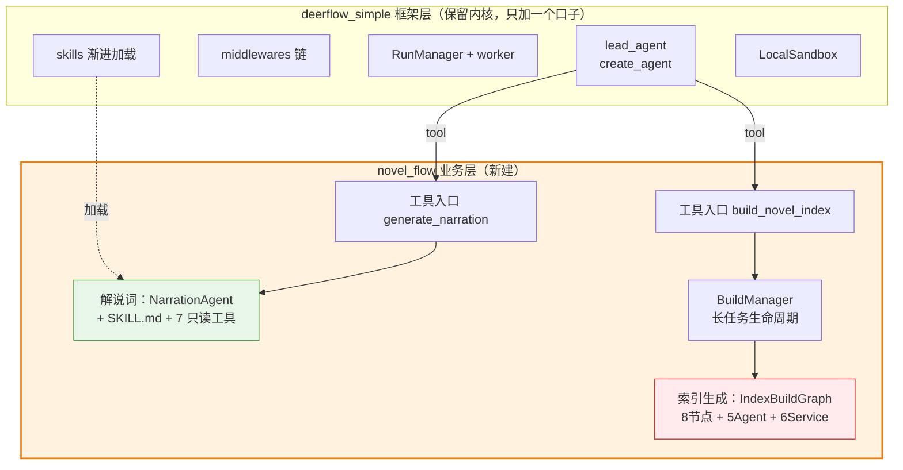

我已经把 `deerflow_simple` 的实现与 `design/` 下的设计文档完整对照分析完了。下面是我的判断：先给结论，再给落地路径，最后是几个**必须纠正的设计问题**。

---

## 一、先看清 `deerflow_simple` 到底是什么

它不是一个"业务框架"，而是一个**单 ReAct Agent 的装配骨架**。核心只有一句话：

```
create_agent(model, tools, middleware, system_prompt, state_schema, checkpointer)
```

它真正能复用的资产是这 9 个"横切能力"，而不是任何业务逻辑：

| 能力 | 能否直接用于二创 |
|---|---|
| `build_agent` 装配（model+tools+middleware+prompt） | ✅ 底座，但要加"注入业务工具"的口子 |
| `middlewares/`（context engineering 链） | ✅ 原样用（摘要/记忆/系统消息合并对长对话有用） |
| `skills/`（渐进加载 SKILL.md） | ✅ **解说词生成的核心载体**，直接复用 |
| `sandbox/` + `read_file/ls/write_file/bash` | ⚠️ 只能给 lead_agent 用，**不能**给索引生成的精读 agent 用（见问题 3） |
| `memory/`（JSON 事实抽取） | ✅ 可用，但不是索引生成的"索引" |
| `subagents/`（`task` 工具） | ⚠️ 通用子代理，索引生成的 5 个 Agent 应**独立**设计，不用它 |
| `runs/`（RunManager + worker 协程） | ⚠️ 范式可借鉴，但**不能直接套**给天级构建任务 |
| MCP / tracing / HTTP API | ✅ 原样用 |

一句话：**deerflow_simple 能承担"lead_agent 外壳"，但承担不了"索引生成的工作流内核"。**

---

## 二、核心判断：两条工作流与 deerflow_simple 的匹配度截然不同

这是整个方案的关键分水岭，决定了落地策略必须"一轻一重"：

```
解说词生成  →  1 ReAct Agent + 1 SKILL.md + ~7 只读工具
              = deerflow_simple 的"原生形态"，几乎零改造，直接长在框架上

索引生成    →  1 StateGraph(8阶段) + 5 Agent + ~20 工具 + 6 Service + 三层断点恢复
              = deerflow_simple 完全没有的"自定义多节点图 + 持久化状态机"
              = 需要在框架之上新建一整套，deerflow_simple 只贡献 lead_agent 入口
```

这个判断与 `02-架构设计.md` 的结论一致（"Pure ReAct：一个主 agent + 两个工作流 tools"），也和 `03-解说词生成.md` v2.0 的"短任务用 skill、长任务用 Graph"一致。

---

## 三、推荐的落地架构



落盘结构（业务包独立于框架，`deerflow_simple/` 几乎不动）：

```
deerflow_simple/                # 框架，改动极小
└── deerflow_simple/
    ├── agent.py                # 唯一要改：build_agent 增加 extra_tools 注入点
    └── ...

novel_flow/                     # 新建业务包
├── lead/                       # lead_agent 的 persona + 两个工作流工具注册
├── narration/                  # 【轻】解说词生成
│   ├── tools.py                #   ~7 个只读工具
│   ├── generate_narration.py   #   工具入口（同步返回）
│   └── skill/novel-narration-generator/   # 已存在于 examples/skills，拷入
└── index/                      # 【重】索引生成
    ├── graph.py                #   IndexBuildGraph（唯一 StateGraph）
    ├── state.py                #   BuildState
    ├── nodes/                  #   8 节点
    ├── agents/                 #   5 个 ReAct Agent
    ├── tools/                  #   A/B/C/E/F 只读工具
    ├── writes/                 #   D 写入（仅节点调用）
    ├── services/               #   ID/Ledger/Name/Fingerprint/Budget/Ref
    └── build_manager.py        #   长任务 task_id 生命周期 + resume
```

---

## 四、三个必须动手的框架改造点（小但关键）

1. **`build_agent` 开一个"业务工具注入口"**
   现在 `build_agent` 内部把工具组装顺序写死了（sandbox → skills → memory → subagents → MCP），没有任何 `extra_tools` 参数。要让 `generate_narration` / `build_novel_index` 挂进 lead_agent，必须加一个 `extra_tools: list` 参数（或 `tool_builders`），在 MCP 之后、`_dedupe_tools` 之前合并进去。

2. **checkpointer 从 `InMemorySaver` 换成可配置的 `SqliteSaver`**
   索引生成是天级任务，`InMemorySaver` 进程重启即丢。至少要支持 `SqliteSaver`，否则设计文档 §4 的三层断点恢复第一层（LangGraph checkpoint）无从谈起。

3. **新建 `BuildManager`，不能复用 `RunManager`**
   `RunManager` 的生命周期是 `pending → running → success/error/interrupted`，一次 astream 消费；而索引生成需要 `task_id → phase 状态机 → halt → resume(decision)`。两者语义完全不同，要独立实现（参考设计文档 §6 的 `start_build/resume_build/query_task_status`）。

---

## 五、分阶段落地顺序（建议）

| 阶段 | 内容 | 依赖 |
|---|---|---|
| M0 | 给 `build_agent` 加 `extra_tools`；checkpointer 可配置化 | 框架小改 |
| M1 | **解说词生成**端到端（skill 已就位，只补 7 个只读工具 + `generate_narration` 入口） | 几乎零风险，先跑通证明"轻"路径 |
| M2 | 索引生成 **单章 PoC**（`ChapterReActAgent` + `LedgerService` 四态 + 一个写入闭环） | 设计文档 §9 也建议"先 M3 再回填 M2" |
| M3 | `IndexBuildGraph` 8 节点 + 5 Agent + 6 Service 全量 | 大头，也是最容易踩坑的地方 |
| M4 | `BuildManager` 长任务异步化 + 断点恢复 + 人工审核 interrupt | 依赖 M3 |
| M5 | 审计节点 + 派生 + eval | 收尾 |

**落地建议**：先 M1 解说词（轻、快、能验证 deerflow_simple 的 skill 机制真正可用），再啃 M2/M3 索引生成。这也符合设计文档"先把最简 skill 跑通再谈回退"的原则。

---

## 六、必须纠正/提醒的设计问题（不能盲从）

1. **`基于deer-flow的二次开发.md` 这个总计划文档在仓库里不存在。**
   `CLAUDE.md` 和 `README` 都引用它（"阶段 0–6""内核保留清单与裁剪策略"），但根目录搜不到。这意味着"外壳大刀砍、内核几乎不动"的裁剪原则目前**没有权威落点**，动手前应先把这份总计划补齐，否则 M0 的框架改造边界没人能拍板。

2. **`02-架构设计.md` 与 `03-核心图设计_解说词生成.md` 版本不一致。**
   `02` 还在描述旧版"解说词工作流"（且内容截断在"收集相关"就没了）；`03-解说词` 已经 v2.0 重置为"1 ReAct Agent + SKILL.md"。**建议以 `03-解说词生成.md` v2.0 为准**，并回填 `02`，否则"解说词到底是不是 StateGraph"会变成隐患。

3. **索引生成设计与 deerflow_simple 的能力存在根本 gap，要有"几乎不能复用"的预期。**
   设计文档 `03-索引生成` 的假设底座是 deer-flow **原版**（完整 StateGraph、SQLite checkpoint、Ledger），而 deerflow_simple 是**大幅精简**版（`InMemorySaver`、无自定义 Graph 组装、无持久化）。**索引生成的 90% 代码要新建**，deerflow_simple 只贡献 lead_agent 入口和 middleware 链。别被"基于 deerflow_simple 实现"这句话误导成"改改就能跑"。

4. **沙箱工具与"只读/写入分离"直接冲突，是最容易被忽略的雷。**
   deerflow_simple 的 `write_file`/`bash` 是给通用 agent 的**裸写工具**。而索引生成的核心约束是"ReAct Agent 只能用只读工具，D 类写入只能由节点函数确定性路径调用，防 LLM 幻觉乱写"。**绝不能**把通用沙箱工具直接塞给 `ChapterReActAgent`，否则"防幻觉写文件"这条底线瞬间被击穿。必须为索引生成单独设计 A/B/C/E/F 只读工具集 + D 写入服务，并与通用沙箱工具隔离。

5. **长任务异步化是 deerflow_simple 的空白区。**
   设计文档 §6 要求 `build_novel_index` 异步返回 `task_id` + `query_build_status` 轮询，但 deerflow_simple 的 worker 是一次性 `astream` 消费。这块（`BuildManager` + 断点续跑 + `interrupt_before` 人工审核）需要**从零设计**，是除索引 Graph 之外的第二个大头。
