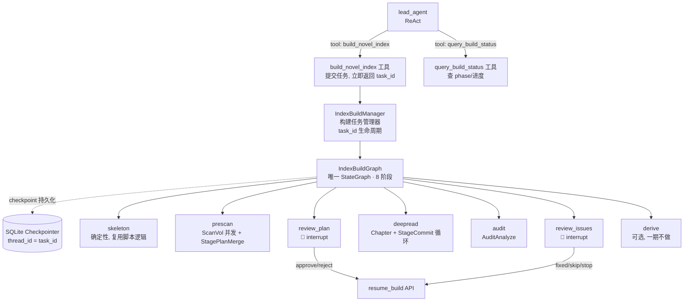

## 一、核心结论：索引生成与解说词是两种完全不同的工作流，不能照搬 narration 模式

这是整个嵌入方案的分歧点，必须先厘清：

| 维度 | 解说词（narration，已实现） | 索引生成（index builder，待实现） |
|---|---|---|
| 生命周期 | 秒~分钟级 | **小时~天级** |
| 返回方式 | **同步返回**完整稿件 | **异步 task_id + 轮询** |
| 状态 | 无状态、一次性 | 有状态机（8 阶段）、可恢复 |
| 中断恢复 | 无 | **checkpoint + ledger 四态** |
| 人机协作 | 无 | **review_plan / review_issues 两个 interrupt** |
| 写入 | 只读（仅写 result 稿件） | **大量确定性写入**（ledger + 分片 + ID 分配） |
| 事件透传 | contextvar 同 task 传播 | **跨 task，contextvar 失效** |

narration 用 `tool-as-workflow-entry`（工具内部 invoke 并同步返回）是成立的，因为它是短任务。但索引生成**绝不能**让 `build_novel_index` 工具同步阻塞数小时——那会把 lead_agent 的 worker 协程卡死。

---

## 二、需要先纠正设计文档《03-核心图设计_索引生成.md》的几个问题

设计文档整体方向正确（唯一 StateGraph + ReAct + 只读/写入分离），但有几处**与 deerflow_simple 现实脱节**，不能盲从：

### 问题 1：`build_novel_index` 的"异步执行"没有落地载体

文档 §6 说"立即返回 task_id，异步执行"，但 deerflow_simple 里**没有**「索引构建任务管理器」这个基础设施。现有 `RunManager` 管的是对话 run（thread_id 维度、准入/串行/取消），而索引构建是 task_id 维度、生命周期完全不同（可跨多次对话、跨进程重启）。**必须新建一个 `IndexBuildManager`**，不能复用 RunManager。

### 问题 2：进度反馈/可观测性没有说清

narration 靠 `stream.py` 的 contextvar 事件桥透传内层事件（已验证同 task 传播）。但索引构建跑在**独立后台协程**，contextvar 不跨 task，事件桥会失效。文档只说 `query_build_status` 轮询，但没定义**用户"看着进度"的体验**怎么做。需要独立的进度查询接口或 SSE 通道。

### 问题 3：Human-in-Loop 的 resume 接口没有落地

文档给了 `resume_build(task_id, decision)` 的伪代码，但 deerflow_simple 目前**没有** interrupt 的持久化、没有对应的 HTTP 端点。这是一整套新增基础设施（interrupt 状态存储 + approve/reject API + resume 触发）。

### 问题 4：`scripts/` 的 4 个脚本不能直接 subprocess 复用

`chunk_novel.py` / `init_skeleton.py` / `shard_chapters.py` / `validate_index.py` 是**独立 CLI 脚本**（硬编码路径、`sys.argv`、直接 `main()`）。deerflow_simple 是 Python 包，不能 subprocess 外部脚本。应把它们的**逻辑迁移为包内模块**（`nodes/skeleton.py` 等），而非脚本调用。

### 问题 5：`derive` 节点（向量索引）一期过度设计

narration 的检索是「关键词 + 文件检索」（`search_name` + `ReadOnlyFs`），**不依赖向量索引**。`derive` 节点（构建向量索引、全文倒排、快照打标签）可以**完全推迟**，一期不做。

### 问题 6：demo 代码是"简化版"，不能直接当成品

`index_create/` 的 demo 命名就暗示了这一点（`prescan_simple` / `deepread_simple` / `audit_simple`），且都硬编码了 `NOVEL_ROOT` 环境变量、用 `init_chat_model` 直接建模型。它们是**验证链路的原型**，不是可嵌入的模块。迁移时要改成：`novel_id` 注入 → 路径解析 → `config` 驱动模型。

---

## 三、推荐的嵌入架构

借鉴 narration 的「工具化工作流入口」模式，但把"同步返回"升级为"异步任务 + 状态查询 + 人机协作"：



### 模块目录（新包 `deerflow_simple/index_builder/`）

```
deerflow_simple/index_builder/
├── __init__.py               # 对外导出 build_novel_index / query_build_status
├── AGENT.md                  # 本模块设计决策
├── state.py                  # BuildState TypedDict（对齐 03 文档 §3）
├── graph.py                  # 唯一 StateGraph 装配（8 阶段 + 路由）
├── nodes/                    # 8 个节点函数（确定性控制流 + 调 Agent）
│   ├── entry.py / skeleton.py / prescan.py
│   ├── deepread.py / audit.py / derive.py
│   └── human_review.py       # 两个 interrupt 节点
├── agents/                   # 5 个 ReAct Agent 装配（复用 create_agent 原语）
│   ├── scan_vol.py / stage_plan_merge.py
│   ├── chapter.py / stage_commit.py / audit_analyze.py
├── tools/                    # A/B/C/E/F 类只读+查询工具（锚定 index root）
├── writes/                   # D 类确定性写入（IndexWriter 迁移）
├── services/                 # ID/Ledger/Name/Fingerprint/Budget/Ref
├── task_manager.py           # IndexBuildManager（准入/后台协程/状态查询/取消）
└── build_novel_index.py      # 工具入口（tool-as-workflow-entry + task_id）
```

### 关键设计决策（对齐现有项目惯例）

1. **路径注入**：`novel_id` 用 `InjectedState("novel_id")` 注入（同 narration），内部 `resolve_novel_index_path(config, novel_id)` 确定性映射到 index root（`workspace/{id}/novel`）。消除 LLM 幻觉路径风险。

2. **写入全走确定性路径**：严格遵循 03 文档 §5.10——ReAct Agent 只产出**结构化结果**（ChapterExtraction / StageCommitPayload），由 `IndexWriter`（迁移自 demo 的 `index_writer.py`）确定性落库。LLM 绝不直接写文件。

3. **checkpointer 用 SQLite**：索引构建跨进程重启，必须用 `AsyncSqliteSaver`（现有 `checkpointer.py` 已支持），`thread_id = task_id`，每个构建任务一条 checkpoint 线程。

4. **预算守护复用 `BudgetGuard`**：deepread 逐章循环里，用现有的 `stream.py::BudgetGuard` 做硬约束（工具调用次数 + token），防止单章 ReAct 死循环。

5. **skeleton 复用脚本逻辑**：把 `scripts/` 的 4 个脚本逻辑**迁移**为 `nodes/skeleton.py` 的纯函数（不依赖 CLI 参数、不依赖 cwd），保持"零 LLM、确定性"。

---

## 四、分阶段落地建议（避免一次性上完整 8 阶段）

对齐设计文档的 M1-M6，但结合 demo 已验证的部分，建议**调整里程碑顺序**：

| 阶段 | 内容 | 复用 demo | 风险 |
|---|---|---|---|
| **P0 骨架+入口** | `index_builder` 包结构 + `build_novel_index`/`query_build_status` 工具 + `IndexBuildManager` + StateGraph 空壳 + SQLite checkpointer | 无（纯新基础设施） | 中 |
| **P1 skeleton+prescan** | 迁移 4 个脚本 → `nodes/skeleton.py`；迁移 `prescan_simple` → `nodes/prescan.py` + `ScanVolAgent` + `StagePlanMergeAgent` | `scripts/` + `prescan_simple.py` | 低 |
| **P2 deepread（核心）** | 迁移 `deepread_simple` + `index_writer` → `nodes/deepread.py` + `writes/`；ChapterReActAgent + StageCommitAgent + ledger 四态 | `deepread_simple.py` + `index_writer.py` | **高**（最复杂） |
| **P3 audit+人机协作** | 迁移 `audit_simple` → `nodes/audit.py`；`interrupt_before` + `resume_build` API | `audit_simple.py` | 中 |
| **P4 收尾** | 进度查询完善、错误恢复、离线重放（`replay_write`） | `replay_write.py` / `archive_staging.py` | 低 |

> **建议先做 P0 + P1**：跑通「建空间 → 上传原文 → build_novel_index → skeleton 初始化 → prescan 出 stage-plan」这条最短链路，验证基础设施（任务管理器 + checkpoint + 路径注入）后再啃 P2 的 deepread 硬骨头。

---

## 五、需要你拍板的 4 个关键决策

在动手前，有几个方向性问题需要你确认，因为它们决定整个模块的形状：

**决策 1：是否新增独立的 `IndexBuildManager`（还是简化）？**
索引构建任务管理器是全新基础设施（task_id 生命周期 + 后台协程 + 状态查询 + 取消）。它和现有 `RunManager` 是两套东西。你希望：
- A. 独立完整实现 `IndexBuildManager`（支持多任务、取消、进度、恢复）——**推荐，工作量较大**
- B. 先做最简版（单任务、内存状态、无取消），后续再补

**决策 2：Human-in-Loop 是否一期就做？**
`review_plan`（阶段计划审核）和 `review_issues`（问题审核）是索引质量的把关点，但需要 interrupt + resume + 前端交互。你希望：
- A. 一期做 `review_plan`（阶段计划必须人工确认才进 deepread）——**推荐**
- B. 一期全自动跑（跳过两个人审节点），后续再加

**决策 3：`derive`（向量索引）是否彻底推迟？**
narration 不依赖向量检索，我建议**彻底推迟** derive。确认吗？

**决策 4：起点是 P0+P1 先跑通最短链路，还是你想直接对齐设计文档完整 8 阶段？**

---

## 我的整体建议

**先做 P0（基础设施）+ P1（skeleton + prescan）**，跑通「原文 → 切块 → 骨架 → 阶段计划」这条**零 LLM 风险最低、确定性最强**的链路。这一步能验证：
- `IndexBuildManager` + task_id + 轮询是否顺畅
- SQLite checkpointer 跨重启恢复
- novel_id → index root 路径注入
- 4 个脚本逻辑迁移为包内模块

之后再啃 P2 的 deepread（真正的核心 + 最复杂），因为那时骨架、阶段计划、ledger 都已经就位，deepread 有了明确的输入。

---

请你确认这 4 个决策（或者直接说"按你的建议来"），我再开始动手实现，并在 `index_builder/AGENT.md` 里同步记录这些设计决策。


deepread

P2a
services/（id_allocator + name_index）+ writes/ledger.py（四态）+ state.py/graph.py 接入空壳 deepread 节点 中，纯确定性，可单测
P2b
tools/（A/B/C/E 类只读工具）+ agents/chapter_react.py + agents/stage_commit_react.py（prompt 从 04 文档抄全，模块级常量） 低，prompt 已给全
P2c
nodes/deepread.py（while 循环编排）+ writes/index_writer.py（迁移 + 修正） 高，最复杂